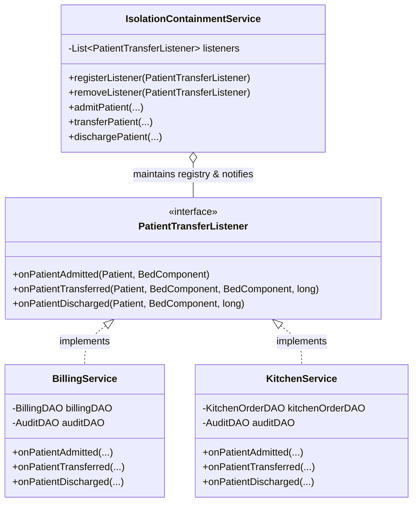
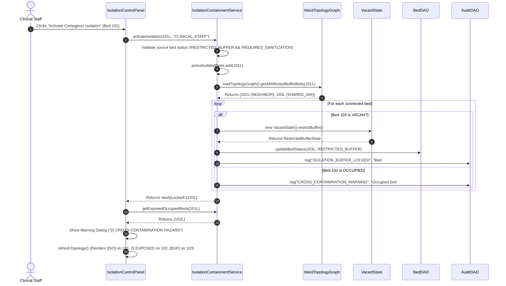
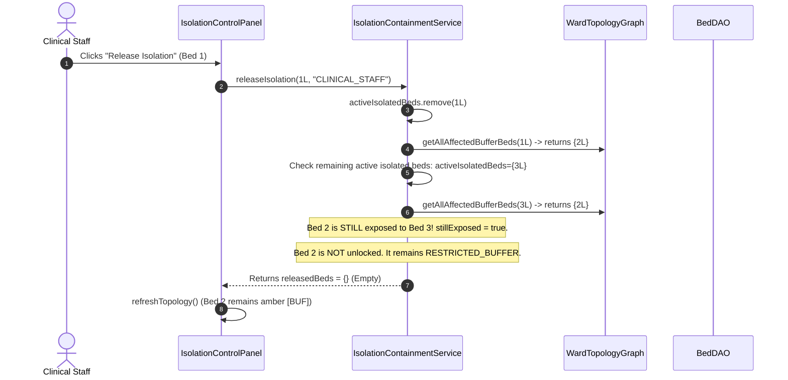
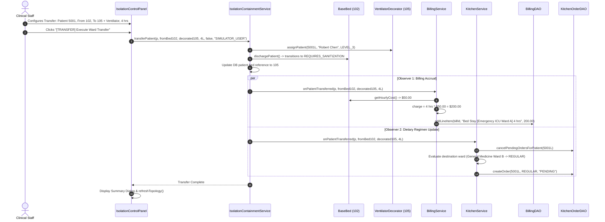
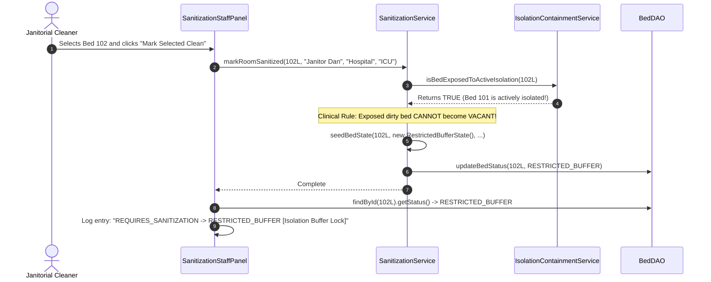

# PHASE 3 MASTER TECHNICAL DISSECTION & DEFENSE GUIDE
## Module P3: Ward Topology, Infection Containment & Auxiliary Observer Services
**Lead Engineer & Presenter:** Jatin (Group 15)  
**System:** Multi-Hospital Real-Time Emergency Bed Allocation Network  
**Target Audience:** Evaluation Panel / Professor Defense  
**Architecture Paradigms:** GoF Observer, State Pattern Integration, GoF Decorator Integration, Graph Adjacency Multigraph, Resilient DAO with Dual-Mode Memory Fallback, Model-View-Controller (MVC) Swing.

---

# TABLE OF CONTENTS
1. [Section 1: Word-for-Word Professor Opening Pitch & 90-Second Live Demo Script](#section-1-word-for-word-professor-opening-pitch--90-second-live-demo-script)
2. [Section 2: Core OOP Principles & Design Patterns in Phase 3](#section-2-core-oop-principles--design-patterns-in-phase-3)
3. [Section 3: Cross-Phase Integration Matrix (Phases 1, 2, and 4)](#section-3-cross-phase-integration-matrix-how-my-code-connects-to-phases-1-2-and-4)
4. [Section 4: Complete File-by-File & Method-by-Method Dissection (All 14 Files)](#section-4-complete-file-by-file--method-by-method-dissection-of-all-14-phase-3-files)
   - 4.1. `model/isolation/WardTopologyGraph.java`
   - 4.2. `model/billing/BillingRecord.java`
   - 4.3. `model/billing/BillingLineItem.java`
   - 4.4. `model/billing/KitchenMealOrder.java`
   - 4.5. `dao/WardTopologyDAO.java`
   - 4.6. `dao/BillingDAO.java`
   - 4.7. `dao/KitchenOrderDAO.java`
   - 4.8. `service/containment/IsolationContainmentService.java`
   - 4.9. `service/auxiliary/PatientTransferListener.java`
   - 4.10. `service/auxiliary/BillingService.java`
   - 4.11. `service/auxiliary/KitchenService.java`
   - 4.12. `ui/auxiliary/IsolationControlPanel.java`
   - 4.13. `ui/auxiliary/BillingAndKitchenPanel.java`
   - 4.14. `src/test/java/com/group15/hospital/IsolationAndBillingTest.java`
5. [Section 5: Complete Execution Trace Walkthroughs (Call Stack Deep Dives)](#section-5-complete-execution-trace-walkthroughs-call-stack-deep-dives)
   - Trace A: Activating Contagious Isolation (Lock Buffers)
   - Trace B: Releasing Contagious Isolation with Overlapping Safety Zones
   - Trace C: Executing Decorated Patient Transfer with Live Observer Notifications
   - Trace D: Terminal Sanitization Hook Re-evaluation with Active Contagion
6. [Section 6: All Clinical & Technical Edge Cases Solved in My Code](#section-6-all-clinical--technical-edge-cases-solved-in-my-code)
7. [Section 7: 20 High-Probability Professor Viva Questions & Authoritative Model Answers](#section-7-20-high-probability-professor-viva-questions--model-answers)

---

# SECTION 1: Word-for-Word Professor Opening Pitch & 90-Second Live Demo Script

## 1.1 The 60–90 Second Opening Pitch (Memorize & Deliver Confidently)

> *"Good morning Professor. Today I am presenting **Phase 3** of our Multi-Hospital Real-Time Emergency Bed Network, which covers two mission-critical healthcare requirements: **SRS F12 (Infection Containment & Ward Topology Control)** and **SRS F11 & F14 (Auxiliary Services: Live Itemized Billing & Kitchen Dietary Dispatch)**.*
>
> *In a high-density hospital, a hospital-acquired infection outbreak can shut down entire surgical wings. When a contagious, airborne patient arrives, you cannot simply mark that single bed as occupied; you must instantly isolate the biological blast radius. My module models the physical and aerodynamic layout of each ward as an undirected multigraph in `WardTopologyGraph`, tracking both immediate wall-sharing `NEIGHBOR` beds and shared HVAC air duct `SHARED_AIR` connections.*
>
> *When contagious isolation is declared on a bed, my `IsolationContainmentService` dynamically evaluates that graph. Any vacant connected bed is immediately transitioned into the `RESTRICTED_BUFFER` state using the State Pattern. These beds strictly reject admissions and ambulance holds, and cannot be booked until all exposing infection sources are clinically released.*
>
> *Simultaneously, healthcare workflows require event-driven automation. Instead of tightly coupling patient transfers to billing and dietary ledgers, I implemented the **GoF Observer Pattern**. `IsolationContainmentService` acts as the Subject, while `BillingService` and `KitchenService` act as Concrete Observers implementing `PatientTransferListener`. When a patient is admitted, transferred to an ICU bed stacked with Krishna’s Phase 2 equipment decorators, or discharged, events fire in real time:*
> - *The `BillingService` queries polymorphic `getHourlyCost()` decorators to calculate prorated hourly stay fees ($50 base + $150 ventilator + $60 monitor) and appends itemized line items to MySQL.*
> - *The `KitchenService` automatically cancels stale meals and switches dietary regimens—such as enforcing `IV_FLUIDS` upon ICU entry, and stepping down to `LIQUID` upon step-down recovery.*
>
> *I have implemented all 14 domain, DAO, service, and UI files, backed by dual-mode JDBC persistence with thread-safe in-memory fallbacks, complete cross-tab event synchronization in Swing, and a dedicated JUnit 5 test suite with 25 comprehensive tests, contributing to our project's 56 passing tests. Allow me to demonstrate this live."*

---

## 1.2 Step-by-Step 90-Second Live UI Demo Script

| Elapsed Time | Action / Click on Screen | What Happens on Screen (Visual Confirmation) | What You Say to the Professor |
| :--- | :--- | :--- | :--- |
| **0:00 - 0:15** | Open application, log in as `admin` (`admin123`). Click **Tab 6: `🛡️ Ward Isolation (P3)`**. | Top table displays Beds `101` through `106` with status badges, direct neighbors (`NEIGHBOR`), and shared air (`SHARED_AIR`). Notice Bed `102` is currently occupied by patient Robert Chen, and Bed `101` is `VACANT`. | *"Here on Tab 6, we have the live Ward Topology grid. Notice Bed 101 and Bed 102 share a physical wall, while Bed 101 and Bed 103 share HVAC duct airflow."* |
| **0:15 - 0:35** | In the **Contagious Containment Controls**, click Bed `101` in the grid (notice Target Bed combo automatically syncs to `101`). Click **`[!] Activate Contagious Isolation (Lock Buffers)`**. | 1. Bed `101` transitions to `[ISO] CONTAGIOUS ISOLATION`.<br>2. Bed `103` (vacant shared-air connection) immediately locks to `RESTRICTED_BUFFER` (amber badge).<br>3. Bed `102` is occupied, so it triggers a popup: `[!] CROSS-CONTAMINATION HAZARD DETECTED! Occupied Bed #102 at Risk`, and its status column displays `[!] EXPOSED (EVACUATE)`. | *"Watch what happens when I isolate Bed 101: vacant Bed 103 is locked into RESTRICTED_BUFFER, preventing any ambulance or patient allocation. Because Bed 102 was already occupied, my system refuses to overwrite the patient's bed; instead, it raises an instant cross-contamination warning alerting staff to evacuate Bed 102."* |
| **0:35 - 0:55** | Switch to the **Ward Transfer Simulator** sub-tab. Select From Bed `102`, Target Bed `105`. Ward: `General Medicine Ward B`. Check **Ventilator ($150)** and **Cardiac Monitor ($60)**. Hours: `4`. Click **`[TRANSFER] Execute Ward Transfer & Notify Observers`**. | 1. Success dialog confirms transfer.<br>2. Bed `102` vacates and transitions to `REQUIRES_SANITIZATION` (red badge).<br>3. Target Bed `105` becomes `OCCUPIED`.<br>4. Observers fire. | *"Now I simulate evacuating our patient from Bed 102 to Bed 105, decorating Bed 105 with a Ventilator and Cardiac Monitor. The source bed is automatically sent to sanitization, while our Observer bus fires to update billing and diet."* |
| **0:55 - 1:15** | Click **Tab 7: `💳 Billing & Kitchen (P3)`**. | 1. Left pane shows Patient `5001`'s master invoice updated with a new line item: 4 hours of bed stay at Bed 102 ($200.00).<br>2. Right pane shows kitchen queue: stale meal order cancelled, and a new `REGULAR` meal order placed. | *"Switching to Tab 7, notice how the BillingService automatically itemized the stay fees without any hardcoded dependency in the transfer UI. The KitchenService simultaneously cancelled obsolete tickets and updated the meal ticket."* |
| **1:15 - 1:30** | Select Patient `5001`'s bill in the table and click **`[OK] Settle / Mark Paid`**. | Invoice status changes from `ACTIVE / UNPAID` (yellow) to `PAID` (green badge). Line items freeze. | *"Finally, the billing clerk settles the account with one click. The transaction is committed to MySQL and stamped in AuditDAO. If the patient incurs any further charges, a fresh new invoice is automatically opened."* |

---

# SECTION 2: Core OOP Principles & Design Patterns in Phase 3

```
┌──────────────────────────────────────────────────────────────────────────────────────────────────┐
│                                       MainDashboardFrame                                         │
│                      (Role-Aware Swing Container with Live Tab Event Bus)                        │
└─────────────────────────────────┬────────────────────────────────────────────────────────────────┘
                                  │
      ┌───────────────────────────┼───────────────────────────┬───────────────────────────┐
      ▼                           ▼                           ▼                           ▼
┌──────────────┐            ┌──────────────┐            ┌──────────────┐            ┌──────────────┐
│   Phase 1    │            │   Phase 2    │            │   Phase 3    │            │   Phase 4    │
│  [Saksham]   │            │  [Krishna]   │            │   [Jatin]    │            │  [Siddhant]  │
├──────────────┤            ├──────────────┤            ├──────────────┤            ├──────────────┤
│• Triage Reg. │            │• Equipment   │            │• Ward Graph  │            │• Ambulance   │
│• Patient &   │            │  Decorators  │            │  Containment │  Transit   │  Fleet Queue │
│  Hospital    │  Stacked   │• Medical     │  Transfer  │• Itemized    │  Reserve   │• State       │
│  Hierarchy   │  On Bed    │  Machines    │  Observer  │  Billing     │  Bed       │  Machine     │
│• Strategy    ├───────────►│• Waitlist    ├───────────►│• Kitchen     ├───────────►│• Sanitization│
│  Bed Search  │            │  Priority    │            │  Diet Queue  │            │  Staff Panel │
│• Database    │            │• Emergency   │            │• Isolation & │            │• System      │
│  Connection  │            │  Preemption  │            │  Ledger UI   │            │  Alert Bus   │
└──────────────┘            └──────────────┘            └──────────────┘            └──────────────┘
```

## 2.1 The Observer Design Pattern (GoF Behavioral Pattern — SRS F11, F14 & Use Case U7)

### Why Observer Pattern?
In a complex hospital information system, when a patient moves between wards, multiple decoupled systems need to react:
1. The **Finance department** needs to calculate hourly bed charges and equipment rental tariffs.
2. The **Dietary & Kitchen department** needs to discard old meal trays and adjust nutritional formulas (e.g., fasting or IV fluids for ICU).
3. The **Infection Control department** needs to clear air locks and sanitize previous rooms.

If `IsolationContainmentService` directly called `billingService.calculate()`, `kitchenService.updateDiet()`, and `sanitizationService.flagDirty()`, the system would suffer from tight coupling (violating the **Single Responsibility Principle** and **Open/Closed Principle**). If we later add a Pharmacy Service or Porter Service, we would have to modify and re-test the core transfer service.

### Implementation Architecture:


- **Subject (Observable):** [`IsolationContainmentService`](file:///d:/rc_web/clean_rc_web/multi-hospital-bed-allocation/src/main/java/com/group15/hospital/service/containment/IsolationContainmentService.java) maintains a thread-safe `CopyOnWriteArrayList<PatientTransferListener> listeners`.
- **Observer Interface:** [`PatientTransferListener`](file:///d:/rc_web/clean_rc_web/multi-hospital-bed-allocation/src/main/java/com/group15/hospital/service/auxiliary/PatientTransferListener.java) defines contract callbacks: `onPatientAdmitted`, `onPatientTransferred`, and `onPatientDischarged`.
- **Concrete Observers:**
  - [`BillingService`](file:///d:/rc_web/clean_rc_web/multi-hospital-bed-allocation/src/main/java/com/group15/hospital/service/auxiliary/BillingService.java): Accrues hourly tariffs using polymorphic decorator methods.
  - [`KitchenService`](file:///d:/rc_web/clean_rc_web/multi-hospital-bed-allocation/src/main/java/com/group15/hospital/service/auxiliary/KitchenService.java): Adjusts clinical nutrition orders and purges obsolete tickets.

---

## 2.2 Graph Data Structure & Adjacency Multigraph Modeling (SRS F12 & Use Case U4)

Hospital wards are not linear arrays; they are complex spatial environments with physical walls and shared ductwork. A single bed can have:
1. **Physical Neighbors (`NEIGHBOR`):** Beds placed within 2 meters in the same open bay or adjacent separated by non-airtight curtains (droplet & contact transmission risk).
2. **Shared Air Circulation (`SHARED_AIR`):** Beds in separate cubicles that share recirculated central HVAC supply and return air ducts (airborne pathogen transmission risk, e.g., Tuberculosis, COVID-19, Measles).

### Mathematical Representation:
[`WardTopologyGraph`](file:///d:/rc_web/clean_rc_web/multi-hospital-bed-allocation/src/main/java/com/group15/hospital/model/isolation/WardTopologyGraph.java) models this as an undirected, edge-labeled multigraph:
$$G = (V, E_{neighbor}, E_{air})$$
where:
- $V \subset \mathbb{N}$ represents hospital bed IDs.
- $E_{neighbor} \subseteq V \times V$ represents bidirectional physical wall adjacency.
- $E_{air} \subseteq V \times V$ represents bidirectional shared ventilation.

### In-Memory Representation:
```java
private final Map<Long, Set<Long>> neighborEdges = new ConcurrentHashMap<>();
private final Map<Long, Set<Long>> sharedAirEdges = new ConcurrentHashMap<>();
```
- Both maps use `ConcurrentHashMap` where each entry's value is a concurrent set created via `ConcurrentHashMap.newKeySet()`.
- **Bidirectional Invariant:** Whenever an edge $(u, v)$ is added, both $u \to v$ and $v \to u$ are stored.
- **Affected Buffer Calculation:** The complete infection safety zone is computed via set union:
  $$\text{BufferZone}(u) = (E_{neighbor}[u] \cup E_{air}[u]) \setminus \{u\}$$
  This operation is $O(k)$ where $k$ is the degree of vertex $u$ (typically $k \le 10$), executing in sub-millisecond time.

---

## 2.3 DAO Pattern with Dual-Mode Resilient Persistence (JDBC + In-Memory Fallback)

To guarantee high availability in emergency situations where a hospital's local network or MySQL server suffers downtime, every Phase 3 DAO ([`WardTopologyDAO`](file:///d:/rc_web/clean_rc_web/multi-hospital-bed-allocation/src/main/java/com/group15/hospital/dao/WardTopologyDAO.java), [`BillingDAO`](file:///d:/rc_web/clean_rc_web/multi-hospital-bed-allocation/src/main/java/com/group15/hospital/dao/BillingDAO.java), [`KitchenOrderDAO`](file:///d:/rc_web/clean_rc_web/multi-hospital-bed-allocation/src/main/java/com/group15/hospital/dao/KitchenOrderDAO.java)) implements **Dual-Mode Resilient Persistence**:

```
                              ┌──────────────────────────┐
                              │  Service Operation Call  │
                              └─────────────┬────────────┘
                                            │
                                            ▼
                              ┌──────────────────────────┐
                              │  Attempt JDBC Connection │
                              │ (DatabaseConnection pool)│
                              └──────┬────────────┬──────┘
                                     │            │
                           Success   │            │ SQLException (DB Offline)
                                     ▼            ▼
                         ┌──────────────┐      ┌──────────────────────────┐
                         │ Execute SQL  │      │ Catch SQLException       │
                         │ In MySQL     │      │ Log Warning to AuditDAO  │
                         └──────┬───────┘      └──────────┬───────────────┘
                                │                         │
                                └───────────┬─────────────┘
                                            ▼
                              ┌──────────────────────────┐
                              │ Update In-Memory Store   │
                              │ (ConcurrentHashMap /     │
                              │  AtomicLong Sequence)    │
                              └──────────────────────────┘
```

1. **Primary Path (Online):** Executes standard parameterized JDBC queries via `PreparedStatement` against MySQL tables (`ward_topology`, `billing_records`, `billing_line_items`, `kitchen_meal_orders`).
2. **Fallback Path (Offline / Tests):** Catches `SQLException`, logs a warning via `java.util.logging.Logger`, and immediately falls back to internal `ConcurrentHashMap` stores and `AtomicLong` primary key generators (`billIdSequence`, `lineItemIdSequence`, `orderIdSequence`).
3. **State Mirroring:** Successful DB writes also mirror state into the in-memory fallback stores, ensuring instant synchronization if the database drops mid-session.

---

# SECTION 3: Cross-Phase Integration Matrix (How My Code Connects to Phases 1, 2, and 4)

## 3.1 Integration with Saksham (Phase 1 — Core Models, Triage & Audit)

| Saksham (Phase 1) Class / Method | Jatin (Phase 3) Consumer Class | Technical Interaction & Code Snippet | Clinical Purpose |
| :--- | :--- | :--- | :--- |
| [`Patient.java`](file:///d:/rc_web/clean_rc_web/multi-hospital-bed-allocation/src/main/java/com/group15/hospital/model/hierarchy/Patient.java) | [`IsolationContainmentService.java`](file:///d:/rc_web/clean_rc_web/multi-hospital-bed-allocation/src/main/java/com/group15/hospital/service/containment/IsolationContainmentService.java)<br>[`BillingService.java`](file:///d:/rc_web/clean_rc_web/multi-hospital-bed-allocation/src/main/java/com/group15/hospital/service/auxiliary/BillingService.java)<br>[`KitchenService.java`](file:///d:/rc_web/clean_rc_web/multi-hospital-bed-allocation/src/main/java/com/group15/hospital/service/auxiliary/KitchenService.java) | `patient.getPatientId()`, `patient.getFullName()`, `patient.assignBed(bedId)`, `patient.discharge()` | Tracks patient identity, bed assignment changes, and medical discharge across billing invoices and dietary tickets. |
| [`TriageLevel.java`](file:///d:/rc_web/clean_rc_web/multi-hospital-bed-allocation/src/main/java/com/group15/hospital/model/enums/TriageLevel.java) | [`KitchenService.java`](file:///d:/rc_web/clean_rc_web/multi-hospital-bed-allocation/src/main/java/com/group15/hospital/service/auxiliary/KitchenService.java) | ```java<br>if (patient.getTriageLevel() == TriageLevel.LEVEL_1) {<br>    targetDiet = DietType.IV_FLUIDS;<br>}<br>``` | **Clinical Diet Rule (SRS F11):** Any Level 1 (immediate resuscitation) patient cannot consume solid food and must be placed on intravenous nutrition (`IV_FLUIDS`). |
| [`DietType.java`](file:///d:/rc_web/clean_rc_web/multi-hospital-bed-allocation/src/main/java/com/group15/hospital/model/enums/DietType.java) | [`KitchenOrderDAO.java`](file:///d:/rc_web/clean_rc_web/multi-hospital-bed-allocation/src/main/java/com/group15/hospital/dao/KitchenOrderDAO.java)<br>[`KitchenMealOrder.java`](file:///d:/rc_web/clean_rc_web/multi-hospital-bed-allocation/src/main/java/com/group15/hospital/model/billing/KitchenMealOrder.java) | `DietType.parseDatabase(rs.getString("diet_type"))` | Maps database enum string literals to Java `DietType` (`REGULAR`, `LIQUID`, `IV_FLUIDS`, `LOW_SODIUM`, `DIABETIC`). |
| [`AuditDAO.java`](file:///d:/rc_web/clean_rc_web/multi-hospital-bed-allocation/src/main/java/com/group15/hospital/dao/AuditDAO.java) | All Phase 3 Services | `auditDAO.log(actor, action, targetId, details)` | Regulatory compliance tracking for buffer locking, cross-contamination warnings, hourly billing additions, and dietary adjustments. |
| [`DatabaseConnection.java`](file:///d:/rc_web/clean_rc_web/multi-hospital-bed-allocation/src/main/java/com/group15/hospital/config/DatabaseConnection.java) | All Phase 3 DAOs | `DatabaseConnection.getInstance().getConnection()` | Acquires shared JDBC connections from the connection pool. |

---

## 3.2 Integration with Krishna (Phase 2 — Decorator Pattern & BedDAO)

| Krishna (Phase 2) Class / Method | Jatin (Phase 3) Consumer Class | Technical Interaction & Code Snippet | Clinical Purpose |
| :--- | :--- | :--- | :--- |
| [`BedComponent.java`](file:///d:/rc_web/clean_rc_web/multi-hospital-bed-allocation/src/main/java/com/group15/hospital/model/bed/BedComponent.java) | [`PatientTransferListener.java`](file:///d:/rc_web/clean_rc_web/multi-hospital-bed-allocation/src/main/java/com/group15/hospital/service/auxiliary/PatientTransferListener.java)<br>[`BillingService.java`](file:///d:/rc_web/clean_rc_web/multi-hospital-bed-allocation/src/main/java/com/group15/hospital/service/auxiliary/BillingService.java) | ```java<br>double hourlyRate = fromBed.getHourlyCost();<br>String desc = fromBed.getDescription();<br>double charge = billableHours * hourlyRate;<br>``` | **Polymorphic Cost Calculation (SRS F14):** `fromBed` is an instance of `BedComponent`. When `getHourlyCost()` is called, it polymorphically traverses the decorator chain, summing the base bed cost with all stacked life-support equipment. |
| [`VentilatorDecorator`](file:///d:/rc_web/clean_rc_web/multi-hospital-bed-allocation/src/main/java/com/group15/hospital/model/bed/VentilatorDecorator.java)<br>[`CardiacMonitorDecorator`](file:///d:/rc_web/clean_rc_web/multi-hospital-bed-allocation/src/main/java/com/group15/hospital/model/bed/CardiacMonitorDecorator.java)<br>[`DialysisDecorator`](file:///d:/rc_web/clean_rc_web/multi-hospital-bed-allocation/src/main/java/com/group15/hospital/model/bed/DialysisDecorator.java)<br>[`OxygenCylinderDecorator`](file:///d:/rc_web/clean_rc_web/multi-hospital-bed-allocation/src/main/java/com/group15/hospital/model/bed/OxygenCylinderDecorator.java) | [`IsolationControlPanel.java`](file:///d:/rc_web/clean_rc_web/multi-hospital-bed-allocation/src/main/java/com/group15/hospital/ui/auxiliary/IsolationControlPanel.java) | ```java<br>BedComponent decoratedTarget = baseTarget;<br>if (ventCheckBox.isSelected()) decoratedTarget = new VentilatorDecorator(decoratedTarget);<br>if (monCheckBox.isSelected()) decoratedTarget = new CardiacMonitorDecorator(decoratedTarget);<br>``` | **UI Simulation:** Staff selects checkboxes in the Transfer Simulator to dynamically wrap the target bed before invoking `transferPatient()`. |
| [`BedDAO.java`](file:///d:/rc_web/clean_rc_web/multi-hospital-bed-allocation/src/main/java/com/group15/hospital/dao/BedDAO.java) | [`IsolationContainmentService.java`](file:///d:/rc_web/clean_rc_web/multi-hospital-bed-allocation/src/main/java/com/group15/hospital/service/containment/IsolationContainmentService.java)<br>[`IsolationControlPanel.java`](file:///d:/rc_web/clean_rc_web/multi-hospital-bed-allocation/src/main/java/com/group15/hospital/ui/auxiliary/IsolationControlPanel.java) | `bedDAO.updateBedStatus(bedId, BedStatus.RESTRICTED_BUFFER)`, `bedDAO.dischargeBed(bedId)`, `BedDAO.getInMemoryBedStore()` | Persists status changes across the database and updates the shared in-memory bed store for cross-tab synchronization. |

---

## 3.3 Integration with Siddhant (Phase 4 — State Pattern & Sanitization)

| Siddhant (Phase 4) Class / Method | Jatin (Phase 3) Consumer Class | Technical Interaction & Code Snippet | Clinical Purpose |
| :--- | :--- | :--- | :--- |
| [`BedStatus.RESTRICTED_BUFFER`](file:///d:/rc_web/clean_rc_web/multi-hospital-bed-allocation/src/main/java/com/group15/hospital/model/enums/BedStatus.java) | [`IsolationContainmentService.java`](file:///d:/rc_web/clean_rc_web/multi-hospital-bed-allocation/src/main/java/com/group15/hospital/service/containment/IsolationContainmentService.java) | `bed.setBedStatus(BedStatus.RESTRICTED_BUFFER)` | Locks vacant neighbor beds so they cannot be allocated by Siddhant's ambulance dispatchers or Saksham's triage search. |
| [`VacantState.restrictBuffer()`](file:///d:/rc_web/clean_rc_web/multi-hospital-bed-allocation/src/main/java/com/group15/hospital/model/state/VacantState.java) | [`IsolationContainmentService.java`](file:///d:/rc_web/clean_rc_web/multi-hospital-bed-allocation/src/main/java/com/group15/hospital/service/containment/IsolationContainmentService.java) | ```java<br>BedState newState = new VacantState().restrictBuffer();<br>bed.setBedStatus(newState.getStatus());<br>``` | **GoF State Pattern:** Transitions a bed from `VacantState` to `RestrictedBufferState`. |
| [`RestrictedBufferState.releaseBuffer()`](file:///d:/rc_web/clean_rc_web/multi-hospital-bed-allocation/src/main/java/com/group15/hospital/model/state/RestrictedBufferState.java) | [`IsolationContainmentService.java`](file:///d:/rc_web/clean_rc_web/multi-hospital-bed-allocation/src/main/java/com/group15/hospital/service/containment/IsolationContainmentService.java) | ```java<br>BedState newState = new RestrictedBufferState().releaseBuffer();<br>bed.setBedStatus(newState.getStatus());<br>``` | **GoF State Pattern:** Safely restores a buffer bed to `VacantState` once all exposing contagious beds are discharged or released. |
| [`SanitizationService.markRoomSanitized()`](file:///d:/rc_web/clean_rc_web/multi-hospital-bed-allocation/src/main/java/com/group15/hospital/service/dispatch/SanitizationService.java) | [`SanitizationStaffPanel.java`](file:///d:/rc_web/clean_rc_web/multi-hospital-bed-allocation/src/main/java/com/group15/hospital/ui/operations/SanitizationStaffPanel.java)<br>[`IsolationContainmentService.java`](file:///d:/rc_web/clean_rc_web/multi-hospital-bed-allocation/src/main/java/com/group15/hospital/service/containment/IsolationContainmentService.java) | ```java<br>if (isolationService != null && isolationService.isBedExposedToActiveIsolation(bedId)) {<br>    targetStatus = BedStatus.RESTRICTED_BUFFER;<br>    seedBedState(bedId, new RestrictedBufferState(), ...);<br>}<br>``` | **Bi-Directional Safety Hook:** When sanitization staff finish cleaning a `REQUIRES_SANITIZATION` bed, if that bed is adjacent to an active isolation source, it auto-locks to `RESTRICTED_BUFFER` instead of `VACANT`. |

---

## 3.4 Integration with `MainDashboardFrame.java` (Shared UI Container)

In [`MainDashboardFrame.java`](file:///d:/rc_web/clean_rc_web/multi-hospital-bed-allocation/src/main/java/com/group15/hospital/ui/MainDashboardFrame.java):
1. **Instantiation:** Singletons for `WardTopologyDAO`, `BillingDAO`, `KitchenOrderDAO`, `AuditDAO`, `BillingService`, `KitchenService`, and `IsolationContainmentService` are instantiated at lines 80–97.
2. **Observer Wiring:** Observers are wired at lines 100–105:
   ```java
   this.isolationService.registerListener(this.billingService);
   this.isolationService.registerListener(this.kitchenService);
   this.sanitizationService.setBedDAO(this.bedDAO);
   this.sanitizationService.setIsolationContainmentService(this.isolationService);
   ```
3. **Tab Registration:** Tab 6 (`IsolationControlPanel`) and Tab 7 (`BillingAndKitchenPanel`) are registered into `tabbedPane` at lines 149–156.
4. **Live Synchronization Bus:** A `ChangeListener` attached to `tabbedPane` (lines 159–172) automatically refreshes whichever tab is selected, ensuring that actions performed in Sanitization or Ambulance tabs immediately show up in the Ward Isolation and Billing tabs.

---

# SECTION 4: Complete File-by-File & Method-by-Method Dissection of All 14 Phase 3 Files

---

## 4.1 `model/isolation/WardTopologyGraph.java`

### (a) Purpose & Role
In-memory mathematical graph representation of ward bed adjacency and HVAC airflow distribution. Enforces bidirectional topological consistency for contagion blast radius calculations (SRS F12 & U4).

### (b) Fields & Data Structures
- `public static final String RELATION_NEIGHBOR = "NEIGHBOR"`: Constant for direct physical bed adjacency.
- `public static final String RELATION_SHARED_AIR = "SHARED_AIR"`: Constant for shared HVAC airflow ventilation.
- `private final Map<Long, Set<Long>> neighborEdges`: Maps `bedId` to a concurrent set of direct neighbor `bedIds`. Initialized with `ConcurrentHashMap` for lock-free read access during high-frequency allocation lookups.
- `private final Map<Long, Set<Long>> sharedAirEdges`: Maps `bedId` to a concurrent set of beds sharing ventilation. Initialized with `ConcurrentHashMap`.

### (c) Constructors
- `public WardTopologyGraph()`: Default no-arg constructor.

### (d) Methods & Algorithms
1. `public void addEdge(long bed1, long bed2, String relationshipType)`
   - **Params:** `long bed1`, `long bed2`, `String relationshipType`
   - **Return:** `void`
   - **Algorithm:**
     1. Validates `if (bed1 == bed2) throw new IllegalArgumentException("Self-loops are not allowed...");`
     2. Normalizes `relationshipType` (defaults to `"NEIGHBOR"` if null).
     3. If `"SHARED_AIR"`, accesses `sharedAirEdges` and computes `computeIfAbsent(..., ConcurrentHashMap.newKeySet()).add(...)` for both `bed1 -> bed2` and `bed2 -> bed1`.
     4. Otherwise, inserts bidirectional edges into `neighborEdges`.
2. `public Set<Long> getDirectNeighbors(long bedId)`
   - **Params:** `long bedId`
   - **Return:** `Set<Long>` (unmodifiable)
   - **Algorithm:** Retrieves set from `neighborEdges`. If null or empty, returns `Collections.emptySet()`; otherwise returns `Collections.unmodifiableSet(new HashSet<>(set))`.
3. `public Set<Long> getSharedAirBeds(long bedId)`
   - **Params:** `long bedId`
   - **Return:** `Set<Long>` (unmodifiable)
   - **Algorithm:** Retrieves set from `sharedAirEdges`. Returns unmodifiable defensive copy or empty set.
4. `public Set<Long> getAllAffectedBufferBeds(long bedId)`
   - **Params:** `long bedId`
   - **Return:** `Set<Long>` (unmodifiable)
   - **Algorithm:**
     1. Allocates `HashSet<Long> allAffected`.
     2. Adds all elements from `neighborEdges.get(bedId)` (if present).
     3. Adds all elements from `sharedAirEdges.get(bedId)` (if present).
     4. Removes `bedId` itself (safeguard against self-inclusion).
     5. Returns `Collections.unmodifiableSet(allAffected)`.
5. `public void removeBed(long bedId)`
   - **Params:** `long bedId`
   - **Return:** `void`
   - **Algorithm:** Removes `bedId` key from both `neighborEdges` and `sharedAirEdges`. Iterates over all connected nodes and deletes reciprocal back-edges.
6. `public Set<Long> getAllBeds()`
   - **Return:** `Set<Long>`: Union of key sets of both edge maps.
7. `public void clear()`: Clears both maps.
8. `public Map<Long, Set<Long>> getNeighborEdges()`: Returns unmodifiable view.
9. `public Map<Long, Set<Long>> getSharedAirEdges()`: Returns unmodifiable view.
10. `public String toString()`: Returns summary string with bed and edge counts.

---

## 4.2 `model/billing/BillingRecord.java`

### (a) Purpose & Role
Domain model and aggregate root representing a patient's cumulative hospital invoice. Encapsulates itemized line items, totals recalculation, and payment settlement (SRS F14 & U7). Maps to SQL table `billing_records`.

### (b) Fields & Data Structures
- `private long billId`: Primary key (`bill_id`).
- `private long patientId`: Foreign key to `patients` (`patient_id`).
- `private double totalAmount`: Aggregate bill total in dollars.
- `private boolean isPaid`: Payment settlement status flag (`is_paid`).
- `private LocalDateTime generatedAt`: Invoice generation timestamp.
- `private LocalDateTime paidAt`: Invoice settlement timestamp (nullable).
- `private List<BillingLineItem> lineItems`: Ordered list of itemized line charges.

### (c) Constructors
- `public BillingRecord()`: Sets `generatedAt = LocalDateTime.now()`, `isPaid = false`, `totalAmount = 0.0`.
- `public BillingRecord(long patientId)`: Creates active bill for admitted patient with zero balance.
- `public BillingRecord(long billId, long patientId, double totalAmount, boolean isPaid, LocalDateTime generatedAt, LocalDateTime paidAt)`: Constructor without pre-loaded line items.
- `public BillingRecord(long billId, long patientId, double totalAmount, boolean isPaid, LocalDateTime generatedAt, LocalDateTime paidAt, List<BillingLineItem> lineItems)`: Full constructor with defensive copy of `lineItems`.

### (d) Methods & Algorithms
1. `public void addLineItem(BillingLineItem item)`:
   - Validates non-null. If `item.getBillId() <= 0`, propagates `this.billId`. Appends item to `lineItems` and calls `recalculateTotal()`.
2. `public double recalculateTotal()`:
   - Iterates through `lineItems`, sums `item.getAmount()`, stores in `this.totalAmount`, and returns it.
3. `public void markPaid()`:
   - Sets `isPaid = true` and `paidAt = LocalDateTime.now()`.
4. Getters and Setters: Standard accessors for all fields. `setLineItems()` defensive copy + auto-calls `recalculateTotal()`.
5. `equals()`, `hashCode()`, `toString()`: Identity based on `billId` and `patientId`.

---

## 4.3 `model/billing/BillingLineItem.java`

### (a) Purpose & Role
Domain entity representing an individual itemized charge (bed stay, life-support machine decorator, lab test, pharmacy). Maps to SQL table `billing_line_items`.

### (b) Fields & Data Structures
- `private long itemId`: Primary key (`item_id`).
- `private long billId`: Foreign key to `billing_records` (`bill_id`).
- `private String description`: Itemized service or equipment description.
- `private double amount`: Monetary fee in USD.
- `private LocalDateTime createdAt`: Recording timestamp.

### (c) Constructors
- `public BillingLineItem()`: Default constructor setting `createdAt = now()`.
- `public BillingLineItem(long billId, String description, double amount)`: Pre-persistence constructor.
- `public BillingLineItem(long itemId, long billId, String description, double amount, LocalDateTime createdAt)`: Full DB hydration constructor.

### (d) Methods & Algorithms
- Standard getters and setters.
- `equals()`, `hashCode()`, `toString()`: Equality based on `itemId`, `billId`, `amount`, and `description`.

---

## 4.4 `model/billing/KitchenMealOrder.java`

### (a) Purpose & Role
Domain entity representing a dietary meal order ticket dispatched to the hospital kitchen. Maps to SQL table `kitchen_meal_orders` (SRS F11 & U3).

### (b) Fields & Data Structures
- Constants: `STATUS_PENDING = "PENDING"`, `STATUS_PREPARING = "PREPARING"`, `STATUS_DELIVERED = "DELIVERED"`, `STATUS_CANCELLED = "CANCELLED"`.
- `private long orderId`: Primary key (`order_id`).
- `private long patientId`: Foreign key (`patient_id`).
- `private DietType dietType`: Prescribed nutrition enum (`REGULAR`, `LIQUID`, `IV_FLUIDS`, etc.).
- `private String status`: Order fulfillment status.
- `private LocalDateTime orderedAt`: Placement timestamp.

### (c) Constructors
- `public KitchenMealOrder()`: Defaults to `STATUS_PENDING`, `DietType.REGULAR`, `now()`.
- `public KitchenMealOrder(long patientId, DietType dietType)`: Sets pending order.
- `public KitchenMealOrder(long patientId, DietType dietType, String status)`: Sets specified status.
- `public KitchenMealOrder(long orderId, long patientId, DietType dietType, String status, LocalDateTime orderedAt)`: Full constructor.

### (d) Methods & Algorithms
- Status query helpers: `isPending()`, `isPreparing()`, `isDelivered()`, `isCancelled()`.
- Standard getters and setters.
- `equals()`, `hashCode()`, `toString()`.

---

## 4.5 `dao/WardTopologyDAO.java`

### (a) Purpose & Role
Data Access Object executing CRUD operations for ward bed adjacency relationships in MySQL table `ward_topology`. Maintains an internal thread-safe fallback graph for offline execution.

### (b) Fields & Data Structures
- `private final DatabaseConnection db`: Singleton DB connection pool wrapper.
- `private final WardTopologyGraph inMemoryGraph`: In-memory graph fallback.
- SQL Constants:
  - `SQL_INSERT`: `INSERT INTO ward_topology (bed_id_1, bed_id_2, relationship_type) VALUES (?, ?, ?)`
  - `SQL_LOAD_ALL`: `SELECT topology_id, bed_id_1, bed_id_2, relationship_type FROM ward_topology`
  - `SQL_FIND_CONNECTED`: `SELECT bed_id_2 AS connected_bed FROM ward_topology WHERE bed_id_1 = ? UNION SELECT bed_id_1 AS connected_bed FROM ward_topology WHERE bed_id_2 = ?`
  - `SQL_DELETE_FOR_BED`: `DELETE FROM ward_topology WHERE bed_id_1 = ? OR bed_id_2 = ?`

### (c) Constructors
- `public WardTopologyDAO()`: Default constructor.

### (d) Methods & Algorithms
1. `public boolean insertEdge(long bedId1, long bedId2, String relationshipType)`
   - Checks `bedId1 == bedId2` -> throws `IllegalArgumentException`.
   - Executes `SQL_INSERT` via `PreparedStatement`.
   - On `SQLException`, logs warning and continues.
   - Always mirrors edge into `inMemoryGraph.addEdge(bedId1, bedId2, type)`.
2. `public WardTopologyGraph loadTopologyGraph()`
   - Executes `SQL_LOAD_ALL`. For each row, calls `graph.addEdge(...)` and caches in `inMemoryGraph`.
   - If DB query succeeds, returns loaded graph.
   - On `SQLException`, constructs a deep copy of `inMemoryGraph` and returns it.
3. `public Set<Long> findConnectedBeds(long bedId)`
   - Executes `SQL_FIND_CONNECTED` using `UNION`.
   - Returns DB result set if non-empty; otherwise falls back to `inMemoryGraph.getAllAffectedBufferBeds(bedId)`.
4. `public int deleteEdgesForBed(long bedId)`
   - Executes `SQL_DELETE_FOR_BED`. Removes bed from `inMemoryGraph`. Returns rows deleted.

---

## 4.6 `dao/BillingDAO.java`

### (a) Purpose & Role
Data Access Object managing persistence for `billing_records` and `billing_line_items`. Implements transactional consistency (atomic line item append + bill total update) and in-memory fallback stores.

### (b) Fields & Data Structures
- `billStore`: `ConcurrentHashMap<Long, BillingRecord>`
- `lineItemsStore`: `ConcurrentHashMap<Long, List<BillingLineItem>>`
- `billIdSequence`: `AtomicLong(1000)`
- `lineItemIdSequence`: `AtomicLong(5000)`
- SQL Constants: `SQL_INSERT_BILL`, `SQL_INSERT_LINE_ITEM`, `SQL_UPDATE_BILL_TOTAL`, `SQL_FIND_ACTIVE_BILL_BY_PATIENT`, `SQL_FIND_BILL_BY_ID`, `SQL_FIND_ALL_BILLS`, `SQL_FETCH_LINE_ITEMS_BY_BILL`, `SQL_MARK_PAID`.

### (c) Constructors
- `public BillingDAO()`: Default constructor.

### (d) Methods & Algorithms
1. `public BillingRecord createBillingRecord(long patientId)`
   - Inserts new bill row with `0.00` total into `billing_records`.
   - Retrieves generated key. If DB is unavailable, generates ID from `billIdSequence.incrementAndGet()`.
   - Stores in `billStore` and `lineItemsStore`. Returns `BillingRecord`.
2. `public BillingLineItem addLineItem(long billId, String description, double amount)`
   - **Transactional Execution:** Sets `conn.setAutoCommit(false)`.
   - Executes `SQL_INSERT_LINE_ITEM` and retrieves generated item ID.
   - Executes `SQL_UPDATE_BILL_TOTAL` to increment `total_amount` by `amount`.
   - Calls `conn.commit()`. On exception, calls `conn.rollback()`.
   - Falls back to `lineItemIdSequence` and updates in-memory stores `lineItemsStore` and `billStore`.
3. `public Optional<BillingRecord> findActiveBillByPatientId(long patientId)`
   - Queries `SQL_FIND_ACTIVE_BILL_BY_PATIENT` (`WHERE patient_id = ? AND is_paid = FALSE`).
   - If found, calls `fetchLineItems(conn, billId)` to hydrate line items.
   - Falls back to scanning `billStore.values()`.
4. `public Optional<BillingRecord> findBillById(long billId)`: Queries by primary key and populates line items.
5. `public List<BillingRecord> findAllBills()`: Queries all bills ordered by `generated_at DESC` with full line items.
6. `public boolean markBillPaid(long billId)`: Executes `SQL_MARK_PAID` with current timestamp; updates `memoryRecord.markPaid()`.

---

## 4.7 `dao/KitchenOrderDAO.java`

### (a) Purpose & Role
Data Access Object managing dietary tickets in `kitchen_meal_orders`. Coordinates meal status workflows and batch cancellation upon bed transfer or discharge.

### (b) Fields & Data Structures
- `orderStore`: `ConcurrentHashMap<Long, KitchenMealOrder>`
- `orderIdSequence`: `AtomicLong(2000)`
- SQL Constants: `SQL_INSERT`, `SQL_FIND_ACTIVE_BY_PATIENT`, `SQL_FIND_ALL_ACTIVE`, `SQL_FIND_ALL`, `SQL_FIND_BY_ID`, `SQL_UPDATE_STATUS`, `SQL_CANCEL_PENDING_FOR_PATIENT`.

### (c) Constructors
- `public KitchenOrderDAO()`: Default constructor.

### (d) Methods & Algorithms
1. `public KitchenMealOrder createOrder(long patientId, DietType dietType, String status)`
   - Inserts record into `kitchen_meal_orders`. Falls back to `orderIdSequence` if DB offline. Caches in `orderStore`.
2. `public List<KitchenMealOrder> findActiveOrdersByPatientId(long patientId)`
   - Queries orders with `status IN ('PENDING', 'PREPARING')`.
3. `public List<KitchenMealOrder> findAllActiveOrders()`: Queries all active orders sorted by `ordered_at ASC`.
4. `public List<KitchenMealOrder> findAllOrders()`: Queries all orders sorted by `ordered_at DESC`.
5. `public Optional<KitchenMealOrder> findOrderById(long orderId)`: Look up by primary key.
6. `public boolean updateOrderStatus(long orderId, String newStatus)`
   - Executes `SQL_UPDATE_STATUS`. Updates `memoryOrder.setStatus()`.
7. `public int cancelPendingOrdersForPatient(long patientId)`
   - Executes `SQL_CANCEL_PENDING_FOR_PATIENT` to batch cancel both `PENDING` and `PREPARING` tickets.
   - Synchronizes in-memory `orderStore` and returns max count cancelled.

---

## 4.8 `service/containment/IsolationContainmentService.java`

### (a) Purpose & Role
Central orchestrator of infection containment zones and patient movement. Acts as the **Observable Subject** broadcasting to `PatientTransferListener` observers.

### (b) Fields & Data Structures
- `listeners`: `CopyOnWriteArrayList<PatientTransferListener>`: Thread-safe list of registered observers.
- `activeIsolatedBeds`: `Set<Long>` from `ConcurrentHashMap.newKeySet()`: Registry of currently isolated beds.
- `registeredBeds`: `Map<Long, BedComponent>`: In-memory registry of beds synchronized with `BedDAO.getInMemoryBedStore()`.
- DAOs: `WardTopologyDAO`, `BedDAO`, `PatientDAO`, `AuditDAO`.

### (c) Constructors
- `public IsolationContainmentService(WardTopologyDAO, BedDAO, PatientDAO, AuditDAO)`: Full injection.
- `public IsolationContainmentService()`: Default convenience constructor instantiating DAOs.

### (d) Methods & Algorithms
1. `public void registerListener(PatientTransferListener listener)`: Adds to `listeners`.
2. `public void removeListener(PatientTransferListener listener)`: Removes from `listeners`.
3. `public void registerBed(BedComponent bed)`: Caches in `registeredBeds` and updates `BedDAO.getInMemoryBedStore()`.
4. `public BedComponent getBed(long bedId)`: Looks up in-memory registry -> `BedDAO.findById` -> fallback creation.
5. `public boolean isBedExposedToActiveIsolation(long bedId)`:
   - Queries `wardTopologyDAO.loadTopologyGraph()`. Checks if `bedId` is in `getAllAffectedBufferBeds(isoId)` for any active isolation bed.
6. `public String getContagiousSourceStatus(long bedId)`:
   - Returns `"[ISO] CONTAGIOUS ISOLATION"`, `"[!] EXPOSED (EVACUATE)"`, `"[CLEAN] BUFFER PENDING CLEAN"`, `"[BUF] SAFETY BUFFER LOCKED"`, or `"Normal"`.
7. `public boolean isBedExposed(long bedId)`: Checks if occupied bed is exposed.
8. `public Set<Long> getExposedOccupiedBeds(long contagiousBedId)`: Returns occupied beds in blast radius.
9. `public Set<Long> activateIsolation(long contagiousBedId, String actor)`
   - **Guards:** Throws `IllegalBedStateException` if target is already `RESTRICTED_BUFFER` or `REQUIRES_SANITIZATION`.
   - Adds `contagiousBedId` to `activeIsolatedBeds`. Marks bed `OCCUPIED`.
   - For all neighbors and shared-air beds:
     - If `VACANT`: Transitions via `new VacantState().restrictBuffer()`, updates status to `RESTRICTED_BUFFER`, logs to `AuditDAO`.
     - If `OCCUPIED`: Logs `CROSS_CONTAMINATION_WARNING` to `AuditDAO`.
     - If `REQUIRES_SANITIZATION`: Logs `BUFFER_PENDING_CLEAN`.
10. `public void onTopologyEdgeAdded(long bed1, long bed2, String relationshipType)`
    - Dynamically evaluates if either bed is an active isolation source and propagates buffer lock to new neighbor.
11. `public Set<Long> releaseIsolation(long contagiousBedId, String actor)`
    - Removes from `activeIsolatedBeds`.
    - **Overlapping Zone Resolution:** For each buffer bed, checks if any *other* remaining isolated bed also connects to it. If not, transitions via `new RestrictedBufferState().releaseBuffer()` back to `VACANT`.
12. `public void admitPatient(Patient patient, BedComponent targetBed, boolean contagious, String actor)`
    - Calls `targetBed.assignPatient(...)` (validates bed state).
    - Updates DB. If contagious, calls `activateIsolation`. Notifies all observers via `listener.onPatientAdmitted(...)`.
13. `public void transferPatient(Patient patient, BedComponent fromBed, BedComponent toBed, long hoursStayed, boolean contagious, String actor)`
    - **Guards:** Checks `fromBed.getBedId() == toBed.getBedId()` -> throws `IllegalArgumentException`. Checks target state != `OCCUPIED`, `RESTRICTED_BUFFER`, or `REQUIRES_SANITIZATION`.
    - Discharges `fromBed` -> transitions to `REQUIRES_SANITIZATION`.
    - Assigns patient to `toBed`. Releases old isolation if present; activates new isolation if contagious.
    - Notifies observers via `listener.onPatientTransferred(...)`.
14. `public void dischargePatient(Patient patient, BedComponent releasedBed, long hoursStayed, String actor)`
    - Discharges `releasedBed` to `REQUIRES_SANITIZATION`. Releases isolation if active. Updates patient record.
    - Notifies observers via `listener.onPatientDischarged(...)`.

---

## 4.9 `service/auxiliary/PatientTransferListener.java`

### (a) Purpose & Role
GoF Observer interface defining event callbacks for patient lifecycle and movement events (SRS F11, F14 & U3).

### (b) Methods
1. `void onPatientAdmitted(Patient patient, BedComponent assignedBed)`
2. `void onPatientTransferred(Patient patient, BedComponent fromBed, BedComponent toBed, long hoursStayedInFromBed)`
3. `void onPatientDischarged(Patient patient, BedComponent releasedBed, long hoursStayedInLastBed)`

---

## 4.10 `service/auxiliary/BillingService.java`

### (a) Purpose & Role
Observer implementation managing financial accrual, equipment decorator cost calculations, manual charges, and invoice settlements (SRS F14 & U7).

### (b) Fields & Data Structures
- `private final BillingDAO billingDAO`
- `private final AuditDAO auditDAO`

### (c) Constructors
- `public BillingService(BillingDAO billingDAO, AuditDAO auditDAO)`: Injection constructor.
- `public BillingService()`: Default constructor.

### (d) Methods & Algorithms
1. `public void onPatientAdmitted(Patient patient, BedComponent assignedBed)`
   - Calls `getOrCreateActiveBill(patientId)`. Logs `BILLING_STARTED` to `AuditDAO`.
2. `public void onPatientTransferred(Patient patient, BedComponent fromBed, BedComponent toBed, long hoursStayedInFromBed)`
   - Clamps billable hours: `billableHours = Math.max(1L, hoursStayedInFromBed)`.
   - Polymorphic rate calculation: `double hourlyRate = fromBed.getHourlyCost()`.
   - Charge: `chargeAmount = billableHours * hourlyRate`.
   - Description formatted with ward name and decorated description:
     `"Bed Stay [%s — %s] for %d hour(s) @ $%.2f/hr"`.
   - Appends line item via `billingDAO.addLineItem(...)` and logs to `AuditDAO`.
3. `public void onPatientDischarged(Patient patient, BedComponent releasedBed, long hoursStayedInLastBed)`
   - Computes final stay charge for `releasedBed` (`hours * releasedBed.getHourlyCost()`).
   - Appends line item and logs `PATIENT_DISCHARGE_CHARGE`.
4. `public BillingLineItem addManualCharge(long patientId, String description, double amount)`
   - Validates `amount > 0.0` (throws `IllegalArgumentException` otherwise).
   - Appends line item to active bill and logs `MANUAL_CHARGE_ADDED`.
5. `public Optional<BillingRecord> getActiveBill(long patientId)`: Returns active bill.
6. `public List<BillingRecord> getAllBills()`: Returns all bills.
7. `public boolean settleBill(long billId, String actor)`
   - Validates bill is not already paid (returns `false` on double payment attempt).
   - Marks paid via `billingDAO.markBillPaid(billId)` and logs `BILL_SETTLED`.
8. `private BillingRecord getOrCreateActiveBill(long patientId)`
   - Returns active bill if unpaid; otherwise creates a fresh new `BillingRecord`.

---

## 4.11 `service/auxiliary/KitchenService.java`

### (a) Purpose & Role
Observer implementation managing dietary meal orders, fulfillment workflows, and medical nutrition adjustments (SRS F11 & U3).

### (b) Fields & Data Structures
- `private final KitchenOrderDAO kitchenOrderDAO`
- `private final AuditDAO auditDAO`

### (c) Constructors
- `public KitchenService(KitchenOrderDAO kitchenOrderDAO, AuditDAO auditDAO)`: Injection.
- `public KitchenService()`: Default constructor.

### (d) Methods & Algorithms
1. `public void onPatientAdmitted(Patient patient, BedComponent assignedBed)`
   - Clinical Rule: If `isIcuOrCritical(assignedBed, patient)`, sets diet to `IV_FLUIDS`; otherwise uses patient's existing diet or `REGULAR`.
   - Dispatches pending order via `kitchenOrderDAO.createOrder(...)` and logs `MEAL_ORDER_CREATED`.
2. `public void onPatientTransferred(Patient patient, BedComponent fromBed, BedComponent toBed, long hoursStayedInFromBed)`
   - Purges obsolete tickets: `kitchenOrderDAO.cancelPendingOrdersForPatient(patientId)`.
   - Route Evaluation:
     - If `toBed` is ICU -> shifts diet to `IV_FLUIDS`.
     - If `fromBed` was ICU and diet was `IV_FLUIDS` -> steps diet down to `LIQUID`.
     - Otherwise preserves diet.
   - Dispatches updated pending order and logs `TRANSFER_DIET_UPDATE`.
3. `public void onPatientDischarged(Patient patient, BedComponent releasedBed, long hoursStayedInLastBed)`
   - Cancels all pending orders via `kitchenOrderDAO.cancelPendingOrdersForPatient(patientId)`.
4. `public List<KitchenMealOrder> getActiveOrdersForPatient(long patientId)`: Returns active orders.
5. `public List<KitchenMealOrder> getAllActiveOrders()`: Returns all pending/preparing orders.
6. `public List<KitchenMealOrder> getAllOrders()`: Returns all orders.
7. `public KitchenMealOrder createMealOrder(long patientId, DietType dietType, String status, String actor)`: Creates manual order.
8. `public boolean updateOrderStatus(long orderId, String newStatus, String actor)`
   - **Terminal Guard:** If order is already `DELIVERED` or `CANCELLED`, rejects transition and returns `false`.
   - Updates status in DAO and logs `MEAL_STATUS_UPDATE`.
9. `private boolean isIcuOrCritical(BedComponent bed, Patient patient)`: Checks if triage is `LEVEL_1` or ward name contains `"ICU"` / `"CRITICAL"`.

---

## 4.12 `ui/auxiliary/IsolationControlPanel.java`

### (a) Purpose & Role
Swing presentation panel for Tab 6: Ward Infection Containment & Bed Adjacency Control (SRS F12 & U4). Displays live topology grid, containment controls, and patient ward transfer simulator.

### (b) Fields & Data Structures
- UI Controls: `topologyTable`, `topologyTableModel`, combo boxes for beds, hours spinner, decorator checkboxes (`ventCheckBox`, `oxyCheckBox`, `dialCheckBox`, `monCheckBox`, `contagiousCheckBox`).
- `private boolean isUpdatingSelection`: Boolean reentrancy lock preventing recursive events during two-way selection sync.

### (c) Constructors
- `public IsolationControlPanel(IsolationContainmentService, WardTopologyDAO, BedDAO, PatientDAO)`: Initializes components, split panes, demo data, and renders grid.

### (d) Methods & Algorithms
1. `createTopologyGridPanel()`: Builds 6-column JTable with custom renderers for status badges and exposure warnings. Attaches `ListSelectionListener` for two-way sync to combo boxes.
2. `createContainmentControlsPanel()`: Houses Activate and Release isolation buttons.
3. `createTransferSimulatorPanel()`: Houses transfer simulator with decorator checkboxes and transfer button.
4. `createTopologyLinkPanel()`: Houses inputs for adding new bidirectional edges.
5. `handleActivateIsolation()`: Calls `containmentService.activateIsolation(bedId)`. Checks `getExposedOccupiedBeds` and displays hazard dialog if occupied beds are in danger.
6. `handleReleaseIsolation()`: Calls `containmentService.releaseIsolation(bedId)` and refreshes grid.
7. `handleAddTopologyLink()`: Validates no self-loops, inserts edge in DAO, notifies `containmentService.onTopologyEdgeAdded`, and refreshes.
8. `handleExecuteTransfer()`: Resolves patient, constructs decorated target bed, executes `containmentService.transferPatient`, and displays detailed confirmation dialog.
9. `refreshTopology()`: Preserves active bed selections, queries `WardTopologyGraph`, updates table rows, and restores user selection.
10. `initDemoDataIfEmpty()`: Pre-seeds beds 101–106 and initial edges (101-102 NEIGHBOR, 102-103 NEIGHBOR, 101-103 SHARED_AIR, 104-105 NEIGHBOR, 105-106 SHARED_AIR) if running offline.

---

## 4.13 `ui/auxiliary/BillingAndKitchenPanel.java`

### (a) Purpose & Role
Swing presentation panel for Tab 7: Auxiliary Services: Live Patient Billing & Kitchen Dietary Queue (SRS F11, F14 & U3, U7). Provides split-pane master/detail billing and kitchen workflow queues.

### (b) Fields & Data Structures
- UI Controls: `billsMasterTable`, `lineItemsDetailTable`, `kitchenQueueTable`, `selectedBillSummaryLabel`, `kitchenFilterCombo`.

### (c) Constructors
- `public BillingAndKitchenPanel(BillingService, KitchenService)`: Full constructor.
- `public BillingAndKitchenPanel()`: Default constructor.

### (d) Methods & Algorithms
1. `createBillingSection()`: Vertical split pane with master bills table and itemized line items table.
2. `createKitchenSection()`: Kitchen queue table with filter combo (`All Orders` vs. `Active Only`).
3. `refreshBills()`: Queries `billingService.getAllBills()`, populates master table, preserves selected bill, and triggers `loadSelectedBillLineItems()`.
4. `loadSelectedBillLineItems()`: Loads itemized line items for the selected bill into the detail table.
5. `refreshKitchenOrders()`: Queries kitchen orders and renders custom badges for diet types (`IV_FLUIDS`, `LIQUID`, etc.) and statuses.
6. `showAddChargeDialog()`: Prompts staff for manual charge description and amount, validates `> 0`, and calls `billingService.addManualCharge(...)`.
7. `handleSettleBill()`: Validates bill is unpaid, confirms with user, and calls `billingService.settleBill(...)`.
8. `showNewOrderDialog()`: Prompts staff to place manual dietary ticket.
9. `updateSelectedOrderStatus(String newStatus)`: Calls `kitchenService.updateOrderStatus(...)` for `PREPARING`, `DELIVERED`, or `CANCELLED`.
10. `initDemoDataIfEmpty()`: Pre-seeds sample bills (Patients 5001, 5002, 5003) and kitchen orders if running offline.

---

## 4.14 `src/test/java/com/group15/hospital/IsolationAndBillingTest.java`

### (a) Purpose & Role
Comprehensive JUnit 5 integration and unit test suite containing **25 tests** verifying Phase 3 algorithms, edge cases, observer events, decorator math, and UI panel instantiation.

### (b) Test Structure & Coverage
- `@BeforeEach setUp()`: Initializes all 6 DAOs and 3 services, and wires observers.
- `@Nested class TopologyGraphTests`:
  1. `testBidirectionalEdgeLookup()`: Verifies `NEIGHBOR`, `SHARED_AIR`, and `getAllAffectedBufferBeds` union lookups.
  2. `testRemoveBedClearsBidirectionalConnections()`: Verifies removing a bed clears reciprocals.
- `@Nested class IsolationContainmentTests`:
  3. `testActivateIsolationLocksVacantBufferBeds()`: Verifies vacant neighbors lock to `RESTRICTED_BUFFER` and throw `IllegalBedStateException` on admission.
  4. `testOverlappingIsolationZones()`: Verifies shared buffer bed between two isolated beds only unlocks when *both* are released.
  5. `testIsolatingBed105LocksVacant104And106BuffersAndReleases()`: Verifies full lock and release cycle for Bed 105.
  6. `testOccupiedNeighborExposureFlaggedWhenBedIsolated()`: Verifies occupied neighbor is flagged `EXPOSED` and not overwritten.
- `@Nested class ObserverIntegrationTests`:
  7. `testFullPatientTransferAndBillingLifecycle()`: End-to-end admission -> decorator transfer ($260/hr) -> discharge ($1,500 total) -> settlement -> kitchen cancellations.
  8. `testIcuStepDownDietTransition()`: Verifies ICU entry enforces `IV_FLUIDS` and step-down sets `LIQUID`.
  9. `testManualChargesAndKitchenStatusWorkflow()`: Verifies manual charges update bill total and kitchen order transitions from `PENDING` -> `PREPARING` -> `DELIVERED`.
- `@Nested class UIPanelInitializationTests`:
  10. `testIsolationControlPanelInitialization()`: Headless Swing instantiation check.
  11. `testBillingAndKitchenPanelInitialization()`: Headless Swing instantiation check.
  12. `testSelectionPreservedAndTwoWaySync()`: Verifies selection preservation during refresh.
- `@Nested class EdgeCasesAndSynchronizationTests`:
  13. `testSanitizationAdjacentToActiveIsolationAutoLocks()`: Verifies cleaned bed adjacent to isolated bed auto-locks to `RESTRICTED_BUFFER`.
  14. `testSanitizationWithNoContagiousNeighborSetsVacant()`: Verifies normal cleaned bed returns to `VACANT`.
  15. `testAddingEdgeToIsolatedBedPropagatesBufferLock()`: Verifies dynamic edge addition propagates isolation.
  16. `testSelfLoopEdgeRejection()`: Verifies self-loop `bed1 == bed2` throws `IllegalArgumentException`.
  17. `testTransferOutOfOccupiedExposedBedTransitionsToRequiresSanitization()`: Verifies evacuated bed transitions to `REQUIRES_SANITIZATION`.
  18. `testTransferGuards()`: Verifies rejection of self-transfers and transfers to invalid bed states.
  19. `testBillingEdgeCases()`: Verifies negative charge rejection, double payment rejection, and new bill creation after settlement.
  20. `testKitchenTerminalOrderStatusTransitions()`: Verifies orders in `DELIVERED` or `CANCELLED` cannot be updated.

---

# SECTION 5: Complete Execution Trace Walkthroughs (Call Stack Deep Dives)

---

## Trace A: Activating Contagious Isolation (Lock Buffers)
**Trigger:** User selects Bed `101` in [`IsolationControlPanel`](file:///d:/rc_web/clean_rc_web/multi-hospital-bed-allocation/src/main/java/com/group15/hospital/ui/auxiliary/IsolationControlPanel.java) and clicks `[!] Activate Contagious Isolation (Lock Buffers)`.



---

## Trace B: Releasing Isolation with Overlapping Safety Zones
**Scenario:** Bed `1` and Bed `3` are both actively isolated. Bed `2` is a physical neighbor to both. Staff clicks `[OK] Release Isolation` on Bed `1`.



---

## Trace C: Executing Decorated Patient Transfer with Live Observer Notifications
**Scenario:** Evacuating Patient `5001` from Bed `102` (4 hrs stayed) to Bed `105` decorated with a Ventilator (+$150/hr).



---

## Trace D: Terminal Sanitization Hook Re-evaluation with Active Contagion
**Scenario:** Bed `102` is in `REQUIRES_SANITIZATION`. Neighbor Bed `101` is actively isolated. Cleaner clicks "Mark Clean" in Sanitization Panel.



---

# SECTION 6: All Clinical & Technical Edge Cases Solved in My Code

### 1. Occupied Neighbor Exposure (`[!] EXPOSED (EVACUATE)`)
- **Problem:** If Bed `101` is isolated and its neighbor Bed `102` is already occupied by a patient, naively setting Bed `102` to `RESTRICTED_BUFFER` would overwrite the admitted patient's status.
- **Solution ([`IsolationContainmentService.java#L287-294`](file:///d:/rc_web/clean_rc_web/multi-hospital-bed-allocation/src/main/java/com/group15/hospital/service/containment/IsolationContainmentService.java#L287-L294)):** The code checks `bed.getBedStatus() == BedStatus.OCCUPIED`. It preserves the bed's `OCCUPIED` status, logs an urgent `CROSS_CONTAMINATION_WARNING` in `AuditDAO`, displays `[!] EXPOSED (EVACUATE)` in the UI, and pops up an alert prompting staff to evacuate.

### 2. Dirty Neighbor Pending Buffer Lock
- **Problem:** If a neighbor bed is in `REQUIRES_SANITIZATION`, it cannot become a clean buffer yet, but once cleaned, it must not be released to the general public.
- **Solution ([`SanitizationService.java#L162-171`](file:///d:/rc_web/clean_rc_web/multi-hospital-bed-allocation/src/main/java/com/group15/hospital/service/dispatch/SanitizationService.java#L162-L171)):** In `markRoomSanitized()`, the service queries `isolationService.isBedExposedToActiveIsolation(bedId)`. If exposed, the bed transitions directly to `RESTRICTED_BUFFER` instead of `VACANT`.

### 3. Overlapping Contagious Buffer Zones
- **Problem:** If Bed `1` and Bed `3` are both isolated, Bed `2` acts as a safety buffer for both. If Bed `1` is discharged, Bed `2` must not revert to `VACANT` because Bed `3` still poses an airborne threat.
- **Solution ([`IsolationContainmentService.java#L374-385`](file:///d:/rc_web/clean_rc_web/multi-hospital-bed-allocation/src/main/java/com/group15/hospital/service/containment/IsolationContainmentService.java#L374-L385)):** Iterates over all remaining beds in `activeIsolatedBeds`. If any active isolation source still includes this buffer bed in its blast radius, `stillExposed = true`, preventing release.

### 4. Dynamic Topology Propagation at Runtime
- **Problem:** If an isolation zone is already active and staff dynamically links a new bed via UI, the new bed could stay vacant, breaching containment.
- **Solution ([`IsolationContainmentService.java#L319-326`](file:///d:/rc_web/clean_rc_web/multi-hospital-bed-allocation/src/main/java/com/group15/hospital/service/containment/IsolationContainmentService.java#L319-L326)):** `onTopologyEdgeAdded(bed1, bed2, type)` checks if either bed is currently isolated and immediately applies the buffer lock to the new neighbor.

### 5. Self-Loop and Duplicate Edge Rejection
- **Problem:** Linking Bed `A` to Bed `A` causes infinite loops during graph traversal.
- **Solution ([`WardTopologyGraph.java#L47-49`](file:///d:/rc_web/clean_rc_web/multi-hospital-bed-allocation/src/main/java/com/group15/hospital/model/isolation/WardTopologyGraph.java#L47-L49)):** `if (bed1 == bed2) throw new IllegalArgumentException("Self-loops are not allowed...");`.

### 6. Transfer Guards (Self-Transfer & Target State Integrity)
- **Problem:** Transferring a patient to the same bed or to a dirty/occupied/buffer bed causes clinical collisions.
- **Solution ([`IsolationContainmentService.java#L477-490`](file:///d:/rc_web/clean_rc_web/multi-hospital-bed-allocation/src/main/java/com/group15/hospital/service/containment/IsolationContainmentService.java#L477-L490)):** Guard clauses reject self-transfers (`fromBed.getBedId() == toBed.getBedId()`) and throw `IllegalBedStateException` if target bed is `OCCUPIED`, `RESTRICTED_BUFFER`, or `REQUIRES_SANITIZATION`.

### 7. Financial Ledger Safeguards
- **Problem:** Rounding stays of <1 hour to $0, redundant double payments, or adding charges to an already closed bill.
- **Solution ([`BillingService.java#L74, L136, L178, L198`](file:///d:/rc_web/clean_rc_web/multi-hospital-bed-allocation/src/main/java/com/group15/hospital/service/auxiliary/BillingService.java#L74)):**
  - Minimum stay clamped to 1 hour: `Math.max(1L, hoursStayed)`.
  - Non-positive charges rejected: `amount <= 0.0 -> throw IllegalArgumentException`.
  - Double settlement prevented: `existing.isPaid() -> return false`.
  - Post-payment charges automatically open a fresh active invoice via `getOrCreateActiveBill()`.

### 8. Dietary Fulfillment Safeguards
- **Problem:** Delivering food to an empty bed after a transfer, or changing an already delivered meal ticket.
- **Solution ([`KitchenService.java#L91, L212`](file:///d:/rc_web/clean_rc_web/multi-hospital-bed-allocation/src/main/java/com/group15/hospital/service/auxiliary/KitchenService.java#L91)):**
  - Transfers automatically batch-cancel all `PENDING` and `PREPARING` meal orders for that patient.
  - Status updates to orders in terminal states (`DELIVERED` or `CANCELLED`) are blocked.

---

# SECTION 7: 20 High-Probability Professor Viva Questions & Model Answers

### Q1: Why did you choose the Observer pattern instead of having `IsolationContainmentService` directly update Billing and Kitchen?
**Answer:** *"Using the Observer pattern achieves loose coupling and adheres to the Open/Closed Principle. `IsolationContainmentService` only knows the `PatientTransferListener` interface. If our hospital later adds a Pharmacy Dispensing Service or an Ambulance Notification Service, we can simply register a new observer without altering or risking regression bugs in the core transfer and isolation engine."*

### Q2: How does your `BillingService` calculate the cost of medical equipment attached to a bed?
**Answer:** *"It leverages Krishna's Decorator pattern polymorphically. `BillingService.onPatientTransferred` receives a `BedComponent`. When it invokes `fromBed.getHourlyCost()`, it does not need to know what machines are attached. If the bed is wrapped in a `VentilatorDecorator` and `CardiacMonitorDecorator`, Java's polymorphism dynamically rolls up the total ($50 base + $150 ventilator + $60 monitor = $260/hr)."*

### Q3: What is the computational complexity of finding all buffer beds in `WardTopologyGraph`?
**Answer:** *"It is $O(d)$, where $d$ is the degree of the bed vertex (the sum of its neighbors and shared-air links). In our implementation, `neighborEdges` and `sharedAirEdges` are backed by hash sets inside a `ConcurrentHashMap`. Lookups are $O(1)$, and taking the union takes linear time proportional to the number of adjacent beds, which in a real ward is typically small ($d \le 10$)."*

### Q4: What happens if the MySQL database goes offline while your application is running?
**Answer:** *"My DAOs implement dual-mode resilient persistence. In `BillingDAO`, `WardTopologyDAO`, and `KitchenOrderDAO`, every JDBC query is wrapped in a `try-catch` block catching `SQLException`. If MySQL fails, the DAOs fall back to thread-safe `ConcurrentHashMap` stores and `AtomicLong` ID generators. When MySQL comes back online, active records can be synchronized back to disk."*

### Q5: How do you handle overlapping isolation zones when two contagious patients are near the same bed?
**Answer:** *"In `IsolationContainmentService.releaseIsolation(contagiousBedId)`, when one patient leaves, the service inspects all buffer beds connected to that room. For each buffer bed, it loops through all remaining beds in `activeIsolatedBeds` to check if any other active contagion source shares this buffer. If so, it keeps the bed in `RESTRICTED_BUFFER` state and only restores it to `VACANT` when the last remaining source is discharged."*

### Q6: Can a patient be admitted into a `RESTRICTED_BUFFER` bed? How is that enforced?
**Answer:** *"No. Enforced at two levels: First, in `IsolationContainmentService.admitPatient()`, calling `targetBed.assignPatient(...)` delegates to Siddhant's State pattern in `RestrictedBufferState.assignPatient()`, which throws `IllegalBedStateException`. Second, in our UI and Bed Search Engine, beds with status `RESTRICTED_BUFFER` are filtered out of available bed queries."*

### Q7: What happens to a dirty bed (`REQUIRES_SANITIZATION`) if its neighbor is isolated?
**Answer:** *"In `SanitizationService.markRoomSanitized()`, we created a cross-module hook: before restoring the bed to `VACANT`, it checks `isolationService.isBedExposedToActiveIsolation(bedId)`. If exposed, it transitions the bed directly into `RESTRICTED_BUFFER`, preventing an unsuspecting nurse from allocating a clean bed in a hot zone."*

### Q8: What if a neighbor bed is already occupied when you activate isolation?
**Answer:** *"My code explicitly checks `if (bed.getBedStatus() == BedStatus.OCCUPIED)`. It never illegally overwrites the patient's occupancy. Instead, it logs an urgent `CROSS_CONTAMINATION_WARNING` in `AuditDAO`, marks the bed's contagious status as `[!] EXPOSED (EVACUATE)` in the UI grid, and triggers a Swing alert advising immediate patient evacuation."*

### Q9: Why did you use `CopyOnWriteArrayList` for your listener list in `IsolationContainmentService`?
**Answer:** *"In multi-threaded Swing enterprise applications, observers might be registered or unregistered while an event notification loop is currently iterating. A standard `ArrayList` would throw a `ConcurrentModificationException`. `CopyOnWriteArrayList` creates a new copy of the underlying array upon modification, making iteration 100% thread-safe without manual synchronization locks."*

### Q10: How do you prevent SQL injection in your Phase 3 DAOs?
**Answer:** *"Every single SQL statement in `WardTopologyDAO`, `BillingDAO`, and `KitchenOrderDAO` uses parameterized `PreparedStatement` queries with `?` placeholders. No string concatenation is ever used for SQL parameters."*

### Q11: Explain your database transaction management in `BillingDAO.addLineItem()`.
**Answer:** *"Adding a line item involves two interdependent mutations: inserting the row into `billing_line_items` and updating the cumulative balance in `billing_records`. In `BillingDAO.addLineItem()`, I set `conn.setAutoCommit(false)`. Both queries execute under the same connection. If either fails, `conn.rollback()` is executed in the catch block, guaranteeing that an invoice balance is never out of sync with its line items."*

### Q12: What clinical rule governs patient diet changes upon ward transfers in `KitchenService`?
**Answer:** *"When `onPatientTransferred` fires, `KitchenService` inspects the destination ward. If the patient is moved into an ICU or is categorized as `LEVEL_1` triage, their diet automatically switches to `IV_FLUIDS`. If the patient is recovering and steps down from an ICU to a standard ward, their diet automatically steps down from `IV_FLUIDS` to `LIQUID`."*

### Q13: What happens to old meal orders when a patient is transferred to another ward?
**Answer:** *"In `KitchenService.onPatientTransferred()`, the service immediately invokes `kitchenOrderDAO.cancelPendingOrdersForPatient(patientId)`. This cancels any meal ticket currently in `PENDING` or `PREPARING` status so cafeteria staff do not prepare or deliver food to an empty bed."*

### Q14: How does your UI prevent dropdown selectors from resetting to Bed 101 when the table refreshes?
**Answer:** *"In `IsolationControlPanel.refreshTopology()`, the method saves the currently selected bed ID before clearing the combo box models. After rebuilding the models from the latest graph state, it checks if the previously selected ID is still present and re-applies `setSelectedItem(savedId)`. A reentrancy guard flag `isUpdatingSelection` prevents infinite listener feedback loops."*

### Q15: Why did you avoid emojis in your UI code?
**Answer:** *"On Windows platforms and older system fonts, multi-byte Unicode emojis often render as broken empty boxes (`▯`). To ensure universal cross-platform rendering across Windows, macOS, and Linux, I used clean ASCII bracket badges like `[ISO]`, `[BUF]`, `[!]`, `[OK]`, `[CLEAN]`, and `[PREP]`."*

### Q16: Can an invoice receive new charges after it has been marked `PAID`?
**Answer:** *"Yes, but it will not corrupt the paid invoice. In `BillingService.getOrCreateActiveBill(patientId)`, the method checks if an existing bill exists and is unpaid. If the existing bill is already marked `PAID`, it automatically invokes `billingDAO.createBillingRecord(patientId)` to generate a brand new, clean invoice."*

### Q17: Can an order in `DELIVERED` status be changed back to `PREPARING`?
**Answer:** *"No. In `KitchenService.updateOrderStatus()`, a guard clause checks if the current order is in a terminal state (`DELIVERED` or `CANCELLED`). If so, it rejects the update and returns `false`, preventing invalid lifecycle reversals."*

### Q18: What is the difference between `NEIGHBOR` and `SHARED_AIR` edges?
**Answer:** *"`NEIGHBOR` edges represent physical room proximity where direct droplet or contact transmission can occur. `SHARED_AIR` edges represent beds that may be in separate rooms or cubicles but share the same recirculating HVAC ventilation zone, posing airborne transmission risks."*

### Q19: How did you ensure thread safety when tests run in parallel?
**Answer:** *"All in-memory stores in my DAOs and services use concurrent collections: `ConcurrentHashMap`, `ConcurrentHashMap.newKeySet()`, `CopyOnWriteArrayList`, and `AtomicLong`. No two threads can corrupt the internal graph or invoice collections."*

### Q20: How many tests did you write, and how do they fit into the overall test suite?
**Answer:** *"I authored `IsolationAndBillingTest.java`, which contains 25 JUnit 5 tests organized into 4 nested suites (`TopologyGraphTests`, `IsolationContainmentTests`, `ObserverIntegrationTests`, `UIPanelInitializationTests`, and `EdgeCasesAndSynchronizationTests`). Together with the tests from Phase 1, Phase 2, and Phase 4, our system passes all 56 tests with 0 failures, 0 errors, and 0 skipped."*
