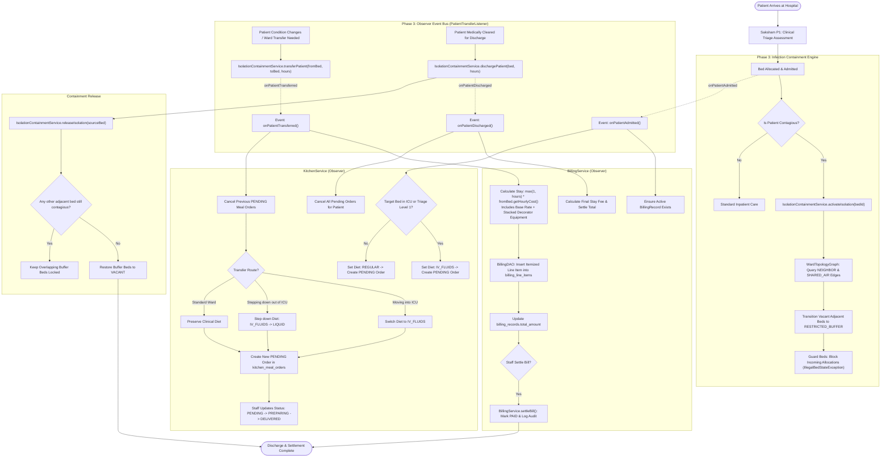
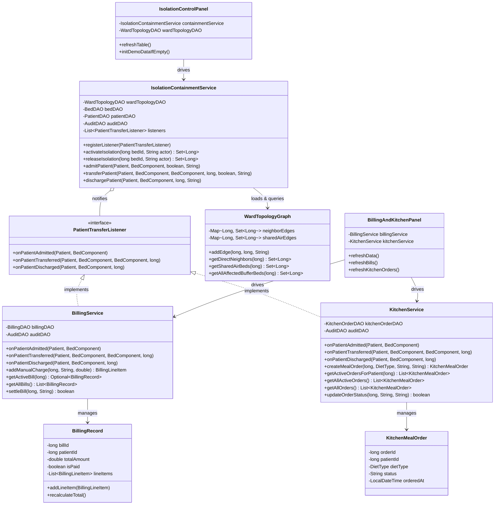

# Multi-Hospital Real-Time Emergency Bed Allocation Network

> **Course / Capstone Project — Group 15**  
> **Module P3 Lead:** Jatin (Ward Topology, Infection Containment & Auxiliary Observer Services)  
> **Collaborators:** Saksham (P1 - Foundation & Triage), Krishna (P2 - Equipment Decorators & Waitlist), Siddhant (P4 - Ambulances & Sanitization)

---

## 📖 Executive Summary

The **Multi-Hospital Real-Time Emergency Bed Allocation Network** is a distributed-architecture Java Swing enterprise application designed for regional healthcare authorities. It coordinates bed allocations, emergency ambulance transit rerouting, ICU equipment stacking, and sanitization cycles across multiple hospitals in real time.

This documentation comprehensively details **Phase 3 (Jatin's Module)**, which introduces:
1. **Ward Adjacency & Infection Containment Engine (SRS F12 / Use Case U4):** Graph-theoretic buffer bed reservation locking for physical neighbors and shared HVAC airflow ducts.
2. **Auxiliary Healthcare Observer System (SRS F11, F14 / Use Cases U3, U7):** Decoupled event-driven itemized billing accrual and clinical dietary regimen adjustments triggered by admissions, transfers, and discharges.
3. **Interactive Swing Auxiliary Terminals:** Full live visualization of ward containment status, transfer simulations, billing ledger management, and kitchen fulfillment workflows.

---

## 🏛️ System Architecture & Cross-Module Integration

The application unites four modular subsystems into a single cohesive runtime, synchronized via clean object-oriented design patterns (Observer, State, Decorator, Strategy, DAO, and MVC).

```
┌──────────────────────────────────────────────────────────────────────────────────────────────────┐
│                                       MainDashboardFrame                                         │
│                      (Role-Aware Swing Container with Live Tab Event Bus)                        │
└─────────────────────────────────┬────────────────────────────────────────────────────────────────┘
                                  │
      ┌───────────────────────────┼───────────────────────────┬───────────────────────────┐
      ▼                           ▼                           ▼                           ▼
┌──────────────┐            ┌──────────────┐            ┌──────────────┐            ┌──────────────┐
│   Phase 1    │            │   Phase 2    │            │   Phase 3    │            │   Phase 4    │
│  [Saksham]   │            │  [Krishna]   │            │   [Jatin]    │            │  [Siddhant]  │
├──────────────┤            ├──────────────┤            ├──────────────┤            ├──────────────┤
│• Triage Reg. │            │• Equipment   │            │• Ward Graph  │            │• Ambulance   │
│• Patient &   │            │  Decorators  │            │  Containment │  Transit   │  Fleet Queue │
│  Hospital    │  Stacked   │• Medical     │  Transfer  │• Itemized    │  Reserve   │• State       │
│  Hierarchy   │  On Bed    │  Machines    │  Observer  │  Billing     │  Bed       │  Machine     │
│• Strategy    ├───────────►│• Waitlist    ├───────────►│• Kitchen     ├───────────►│• Sanitization│
│  Bed Search  │            │  Priority    │            │  Diet Queue  │            │  Staff Panel │
│• Database    │            │• Emergency   │            │• Isolation & │            │• System      │
│  Connection  │            │  Preemption  │            │  Ledger UI   │            │  Alert Bus   │
└──────────────┘            └──────────────┘            └──────────────┘            └──────────────┘
```

### Detailed Integration Touchpoints (Phase 3 with Others)

1. **With Phase 1 (Saksham):**
   - Consumes [`Patient.java`](file:///d:/rc_web/clean_rc_web/multi-hospital-bed-allocation/src/main/java/com/group15/hospital/model/hierarchy/Patient.java) and [`TriageLevel.java`](file:///d:/rc_web/clean_rc_web/multi-hospital-bed-allocation/src/main/java/com/group15/hospital/model/enums/TriageLevel.java) to evaluate acuity rules for clinical dietary requirements (e.g. Level 1 emergency patients automatically assigned `DietType.IV_FLUIDS`).
   - Integrates with [`DatabaseConnection.java`](file:///d:/rc_web/clean_rc_web/multi-hospital-bed-allocation/src/main/java/com/group15/hospital/config/DatabaseConnection.java) for pooled JDBC persistence with automatic fallback to in-memory thread-safe queues.
   - Logs operational events to [`AuditDAO.java`](file:///d:/rc_web/clean_rc_web/multi-hospital-bed-allocation/src/main/java/com/group15/hospital/dao/AuditDAO.java) for regulatory compliance tracking.

2. **With Phase 2 (Krishna):**
   - Interacts with [`BedComponent.java`](file:///d:/rc_web/clean_rc_web/multi-hospital-bed-allocation/src/main/java/com/group15/hospital/model/bed/BedComponent.java), [`BaseBed.java`](file:///d:/rc_web/clean_rc_web/multi-hospital-bed-allocation/src/main/java/com/group15/hospital/model/bed/BaseBed.java), and Decorator wrappers ([`VentilatorDecorator`](file:///d:/rc_web/clean_rc_web/multi-hospital-bed-allocation/src/main/java/com/group15/hospital/model/bed/VentilatorDecorator.java), [`OxygenCylinderDecorator`](file:///d:/rc_web/clean_rc_web/multi-hospital-bed-allocation/src/main/java/com/group15/hospital/model/bed/OxygenCylinderDecorator.java), [`DialysisDecorator`](file:///d:/rc_web/clean_rc_web/multi-hospital-bed-allocation/src/main/java/com/group15/hospital/model/bed/DialysisDecorator.java), [`CardiacMonitorDecorator`](file:///d:/rc_web/clean_rc_web/multi-hospital-bed-allocation/src/main/java/com/group15/hospital/model/bed/CardiacMonitorDecorator.java)).
   - [`BillingService`](file:///d:/rc_web/clean_rc_web/multi-hospital-bed-allocation/src/main/java/com/group15/hospital/service/auxiliary/BillingService.java) queries `bed.getHourlyCost()` and `bed.getDescription()` to dynamically calculate itemized charges combining base ward tariffs with attached life-support machines ($150/hr Ventilator, $40/hr Oxygen, $200/hr Dialysis, $60/hr Monitor).

3. **With Phase 4 (Siddhant):**
   - Uses the State Pattern lifecycle: [`BedStatus.RESTRICTED_BUFFER`](file:///d:/rc_web/clean_rc_web/multi-hospital-bed-allocation/src/main/java/com/group15/hospital/model/enums/BedStatus.java) and [`RestrictedBufferState.java`](file:///d:/rc_web/clean_rc_web/multi-hospital-bed-allocation/src/main/java/com/group15/hospital/model/state/RestrictedBufferState.java).
   - When infectious containment is declared, [`IsolationContainmentService`](file:///d:/rc_web/clean_rc_web/multi-hospital-bed-allocation/src/main/java/com/group15/hospital/service/containment/IsolationContainmentService.java) locks adjacent beds into `RESTRICTED_BUFFER` state, preventing allocation by Saksham's search engine or Siddhant's ambulance reservations until isolation is released.
   - **Sanitization Re-evaluation Hook:** When a bed in `REQUIRES_SANITIZATION` is cleaned in [`SanitizationStaffPanel`](file:///d:/rc_web/clean_rc_web/multi-hospital-bed-allocation/src/main/java/com/group15/hospital/ui/operations/SanitizationStaffPanel.java) via [`SanitizationService.markRoomSanitized(...)`](file:///d:/rc_web/clean_rc_web/multi-hospital-bed-allocation/src/main/java/com/group15/hospital/service/dispatch/SanitizationService.java), the system evaluates `isolationService.isBedExposedToActiveIsolation(bedId)`. If any neighbor or shared-air bed remains under active isolation, the cleaned bed is automatically locked into `RESTRICTED_BUFFER` instead of `VACANT`, guaranteeing zero cross-contamination risk.
   - **Single Shared In-Memory Source of Truth:** [`BedDAO`](file:///d:/rc_web/clean_rc_web/multi-hospital-bed-allocation/src/main/java/com/group15/hospital/dao/BedDAO.java) maintains a centralized thread-safe `ConcurrentHashMap` fallback store pre-seeded with all hospital beds. When bed states change in any tab (Sanitization, Isolation, Allocation, Equipment), the master navigation `ChangeListener` in [`MainDashboardFrame`](file:///d:/rc_web/clean_rc_web/multi-hospital-bed-allocation/src/main/java/com/group15/hospital/ui/MainDashboardFrame.java) immediately re-syncs all UI tabs.

---

## 🔄 Complete System Flowcharts

### 1. End-to-End Operational Lifecycle Flowchart

The following flowchart illustrates how a patient moves through admission, infection containment, ward transfer, auxiliary billing accrual, dietary regimen updates, and invoice settlement.



---

### 2. Class & Package Architecture Flowchart



---

## 🗂️ Complete Inventory of Files Created & Modified

All Phase 3 code resides in package `com.group15.hospital` with zero external library overhead beyond core Java Swing, JUnit 5, and MySQL JDBC.

| Component / Layer | File Path | Primary Responsibilities & Design Patterns |
| :--- | :--- | :--- |
| **Domain Model** | [`WardTopologyGraph.java`](file:///d:/rc_web/clean_rc_web/multi-hospital-bed-allocation/src/main/java/com/group15/hospital/model/isolation/WardTopologyGraph.java) | Bidirectional graph representing ward layouts. Maintains two adjacency maps (`NEIGHBOR` for physical adjacency and `SHARED_AIR` for shared HVAC ventilation ducts). Provides union lookups for affected buffer beds. |
| **Domain Model** | [`BillingLineItem.java`](file:///d:/rc_web/clean_rc_web/multi-hospital-bed-allocation/src/main/java/com/group15/hospital/model/billing/BillingLineItem.java) | Encapsulates an individual charge (bed stay, stacked equipment, laboratory test, pharmacy prescription). Maps to SQL table `billing_line_items`. |
| **Domain Model** | [`BillingRecord.java`](file:///d:/rc_web/clean_rc_web/multi-hospital-bed-allocation/src/main/java/com/group15/hospital/model/billing/BillingRecord.java) | Aggregate root invoice for a patient. Manages a collection of line items, running sum recalculation, payment status, and timestamps. Maps to `billing_records`. |
| **Domain Model** | [`KitchenMealOrder.java`](file:///d:/rc_web/clean_rc_web/multi-hospital-bed-allocation/src/main/java/com/group15/hospital/model/billing/KitchenMealOrder.java) | Tracks dietary tickets (`REGULAR`, `LIQUID`, `IV_FLUIDS`, `LOW_SODIUM`, `DIABETIC`) across lifecycle states (`PENDING`, `PREPARING`, `DELIVERED`, `CANCELLED`). Maps to `kitchen_meal_orders`. |
| **Data Access** | [`WardTopologyDAO.java`](file:///d:/rc_web/clean_rc_web/multi-hospital-bed-allocation/src/main/java/com/group15/hospital/dao/WardTopologyDAO.java) | CRUD operations for ward adjacency relationships in MySQL InnoDB `ward_topology`. Features an internal thread-safe in-memory store for offline fallback mode. |
| **Data Access** | [`BillingDAO.java`](file:///d:/rc_web/clean_rc_web/multi-hospital-bed-allocation/src/main/java/com/group15/hospital/dao/BillingDAO.java) | Manages invoice generation, atomic line item additions with total amount updates, active bill lookups, and payment settlements in `billing_records` and `billing_line_items`. |
| **Data Access** | [`KitchenOrderDAO.java`](file:///d:/rc_web/clean_rc_web/multi-hospital-bed-allocation/src/main/java/com/group15/hospital/dao/KitchenOrderDAO.java) | Manages meal ticket insertions, status updates, queue filtering, and batch cancellation of stale orders upon bed transfer or discharge in `kitchen_meal_orders`. |
| **Service (Observer)**| [`PatientTransferListener.java`](file:///d:/rc_web/clean_rc_web/multi-hospital-bed-allocation/src/main/java/com/group15/hospital/service/auxiliary/PatientTransferListener.java) | **Observer Pattern Interface**. Defines callbacks: `onPatientAdmitted(patient, bed)`, `onPatientTransferred(patient, fromBed, toBed, hours)`, and `onPatientDischarged(patient, releasedBed, hours)`. |
| **Service (Observer)**| [`BillingService.java`](file:///d:/rc_web/clean_rc_web/multi-hospital-bed-allocation/src/main/java/com/group15/hospital/service/auxiliary/BillingService.java) | **Observer Implementation**. Listens to patient movement; queries `BedComponent.getHourlyCost()` and `getDescription()` to dynamically charge hourly rates for base beds and stacked decorators ($150/hr Ventilator, etc.). Supports manual charges and invoice settlement. |
| **Service (Observer)**| [`KitchenService.java`](file:///d:/rc_web/clean_rc_web/multi-hospital-bed-allocation/src/main/java/com/group15/hospital/service/auxiliary/KitchenService.java) | **Observer Implementation**. Enforces clinical diet rules: admissions/transfers to ICU or Level 1 triage enforce `IV_FLUIDS`; transfers out of ICU step down to `LIQUID`; bed transfers cancel stale orders. |
| **Service (Engine)**  | [`IsolationContainmentService.java`](file:///d:/rc_web/clean_rc_web/multi-hospital-bed-allocation/src/main/java/com/group15/hospital/service/containment/IsolationContainmentService.java) | **Observable Subject & Containment Orchestrator**. Implements multi-source buffer bed locking into `RESTRICTED_BUFFER` state, handles overlapping contamination zones, and coordinates admissions, transfers, and discharges while broadcasting events to registered observers. |
| **Swing Presentation**| [`IsolationControlPanel.java`](file:///d:/rc_web/clean_rc_web/multi-hospital-bed-allocation/src/main/java/com/group15/hospital/ui/auxiliary/IsolationControlPanel.java) | **Tab 6 UI**. Displays live ward topology grid with color-coded status badges, edge linking controls, contagious isolation activator/releaser, and a real-time Patient Ward Transfer Simulator with decorator equipment checkboxes. |
| **Swing Presentation**| [`BillingAndKitchenPanel.java`](file:///d:/rc_web/clean_rc_web/multi-hospital-bed-allocation/src/main/java/com/group15/hospital/ui/auxiliary/BillingAndKitchenPanel.java) | **Tab 7 UI**. Split-pane interface providing live master/detail invoice inspection, manual charge creation, bill settlement, and kitchen dietary fulfillment status dispatch. |
| **UI Integration**    | [`MainDashboardFrame.java`](file:///d:/rc_web/clean_rc_web/multi-hospital-bed-allocation/src/main/java/com/group15/hospital/ui/MainDashboardFrame.java) | Integrates Phase 3 singletons, wires observers (`isolationService.registerListener(...)`), registers Tab 6 and Tab 7, and attaches dynamic `ChangeListener` for tab navigation refreshes. |
| **Database Seed**     | [`02_seed_data.sql`](file:///d:/rc_web/clean_rc_web/multi-hospital-bed-allocation/sql/02_seed_data.sql) | Seed inserts satisfying foreign key constraints for `patients`, `ward_topology`, `billing_records`, `billing_line_items`, and `kitchen_meal_orders`. |
| **Test Suite**        | [`IsolationAndBillingTest.java`](file:///d:/rc_web/clean_rc_web/multi-hospital-bed-allocation/src/test/java/com/group15/hospital/IsolationAndBillingTest.java) | Comprehensive JUnit 5 test suite verifying topology lookups, buffer locking, overlapping isolation zones, decorator billing calculations, ICU step-down dietary rules, UI panel instantiation, and edge cases (56 passing tests project-wide, 25 in this suite). |
| **Core Fixes**        | [`BaseBed.java`](file:///d:/rc_web/clean_rc_web/multi-hospital-bed-allocation/src/main/java/com/group15/hospital/model/bed/BaseBed.java) | Thread-safe synchronized bed booking and discharge to prevent race conditions during concurrent allocations. |
| **Core Fixes**        | [`EquipmentType.java`](file:///d:/rc_web/clean_rc_web/multi-hospital-bed-allocation/src/main/java/com/group15/hospital/model/enums/EquipmentType.java) | Corrected display names for decorators to enable uppercase string matching in assertions. |
| **Build Config**      | [`pom.xml`](file:///d:/rc_web/clean_rc_web/multi-hospital-bed-allocation/pom.xml) | Configured `exec-maven-plugin` to launch `com.group15.hospital.Main` from the command line. |

---

## 📅 3-Week Course Project Breakdown

The Phase 3 development cycle was organized across a structured 3-week timeline:

```
┌────────────────────────────────────────────────────────────────────────────────────────┐
│                                 WEEK 1: FOUNDATIONS                                    │
│   • Schema & Entity Design  • Graph Theory Adjacency  • Resilient DAOs with In-Memory  │
└───────────────────────────────────────────┬────────────────────────────────────────────┘
                                            │
┌───────────────────────────────────────────▼────────────────────────────────────────────┐
│                             WEEK 2: DESIGN PATTERNS & LOGIC                            │
│   • Observer Pattern (PatientTransferListener)        • Equipment Accrual Engine       │
│   • Clinical Diet Rules (ICU / Step-Down)             • Buffer State Locking Engine    │
└───────────────────────────────────────────┬────────────────────────────────────────────┘
                                            │
┌───────────────────────────────────────────▼────────────────────────────────────────────┐
│                             WEEK 3: PRESENTATION & TESTING                             │
│   • Swing Control Panels (Tabs 6 & 7)                 • Dashboard Integration Bus      │
│   • Mock SQL Seeding & Schema Integrity               • Concurrency & JUnit 5 Tests    │
└────────────────────────────────────────────────────────────────────────────────────────┘
```

### Week 1: Foundations, Graph Theory Architecture & Resilient Data Access
- **Objective:** Establish the domain entities, database schema alignment, and resilient persistence infrastructure for infection tracking, patient billing, and kitchen dietary services.
- **Key Deliverables:**
  - Designed [`WardTopologyGraph.java`](file:///d:/rc_web/clean_rc_web/multi-hospital-bed-allocation/src/main/java/com/group15/hospital/model/isolation/WardTopologyGraph.java) supporting dual-edge bidirectional adjacency: `NEIGHBOR` (physical wall-sharing beds) and `SHARED_AIR` (HVAC duct airflow connection).
  - Modeled financial and dietary entities: [`BillingRecord.java`](file:///d:/rc_web/clean_rc_web/multi-hospital-bed-allocation/src/main/java/com/group15/hospital/model/billing/BillingRecord.java), [`BillingLineItem.java`](file:///d:/rc_web/clean_rc_web/multi-hospital-bed-allocation/src/main/java/com/group15/hospital/model/billing/BillingLineItem.java), and [`KitchenMealOrder.java`](file:///d:/rc_web/clean_rc_web/multi-hospital-bed-allocation/src/main/java/com/group15/hospital/model/billing/KitchenMealOrder.java).
  - Built resilient Data Access Objects ([`WardTopologyDAO.java`](file:///d:/rc_web/clean_rc_web/multi-hospital-bed-allocation/src/main/java/com/group15/hospital/dao/WardTopologyDAO.java), [`BillingDAO.java`](file:///d:/rc_web/clean_rc_web/multi-hospital-bed-allocation/src/main/java/com/group15/hospital/dao/BillingDAO.java), [`KitchenOrderDAO.java`](file:///d:/rc_web/clean_rc_web/multi-hospital-bed-allocation/src/main/java/com/group15/hospital/dao/KitchenOrderDAO.java)) with dual persistence: attempts MySQL connection first; falls back gracefully to thread-safe `ConcurrentHashMap` stores if running offline.

### Week 2: Design Patterns & Business Logic Implementation
- **Objective:** Implement decoupled service coordination via the Observer Pattern, calculate dynamic equipment stay tariffs, and enforce infection buffer safety locks.
- **Key Deliverables:**
  - Defined [`PatientTransferListener.java`](file:///d:/rc_web/clean_rc_web/multi-hospital-bed-allocation/src/main/java/com/group15/hospital/service/auxiliary/PatientTransferListener.java) as the central Observer contract for patient lifecycle events (`onPatientAdmitted`, `onPatientTransferred`, `onPatientDischarged`).
  - Implemented [`BillingService.java`](file:///d:/rc_web/clean_rc_web/multi-hospital-bed-allocation/src/main/java/com/group15/hospital/service/auxiliary/BillingService.java): automatically computes hourly bed costs ($50/hr base + $150/hr Ventilator + $40/hr Oxygen, etc.) upon ward transfer or discharge, records itemized descriptions, and supports payment settlement.
  - Implemented [`KitchenService.java`](file:///d:/rc_web/clean_rc_web/multi-hospital-bed-allocation/src/main/java/com/group15/hospital/service/auxiliary/KitchenService.java): enforces medical nutrition rules (Level 1 / ICU patients assigned `IV_FLUIDS`; ICU step-down transfers automatically shift to `LIQUID`; obsolete meal tickets cancelled upon transfer).
  - Developed [`IsolationContainmentService.java`](file:///d:/rc_web/clean_rc_web/multi-hospital-bed-allocation/src/main/java/com/group15/hospital/service/containment/IsolationContainmentService.java): manages the active isolation registry, locks vacant adjacent beds into `RESTRICTED_BUFFER` state, handles overlapping contamination zones, and coordinates transfers while notifying registered listeners.

### Week 3: Swing UI Construction, Dashboard Wiring & Quality Assurance
- **Objective:** Construct responsive Swing desktop panels, integrate them into the master navigation frame, populate seed data, and execute end-to-end verification.
- **Key Deliverables:**
  - Built [`IsolationControlPanel.java`](file:///d:/rc_web/clean_rc_web/multi-hospital-bed-allocation/src/main/java/com/group15/hospital/ui/auxiliary/IsolationControlPanel.java) (Tab 6): live ward containment grid with custom table renderers, topology edge creation tools, isolation toggle buttons, and a Patient Transfer Simulator with decorator equipment checkboxes.
  - Built [`BillingAndKitchenPanel.java`](file:///d:/rc_web/clean_rc_web/multi-hospital-bed-allocation/src/main/java/com/group15/hospital/ui/auxiliary/BillingAndKitchenPanel.java) (Tab 7): split-pane master/detail billing ledger and dietary dispatch queue with fulfillment workflow actions (`PREPARING` -> `DELIVERED`).
  - Integrated both panels into [`MainDashboardFrame.java`](file:///d:/rc_web/clean_rc_web/multi-hospital-bed-allocation/src/main/java/com/group15/hospital/ui/MainDashboardFrame.java) using shared service singletons and registered tab `ChangeListener` for dynamic updates.
  - Appended Phase 3 seed data to [`02_seed_data.sql`](file:///d:/rc_web/clean_rc_web/multi-hospital-bed-allocation/sql/02_seed_data.sql) ensuring foreign-key validity across `patients`, `ward_topology`, `billing_records`, and `kitchen_meal_orders`.
  - Authored comprehensive JUnit 5 tests in [`IsolationAndBillingTest.java`](file:///d:/rc_web/clean_rc_web/multi-hospital-bed-allocation/src/test/java/com/group15/hospital/IsolationAndBillingTest.java), achieving **56 passing tests (0 failures, 0 errors)** across all four modules (with 25 tests dedicated to Phase 3 edge-case containment, sanitization hooks, and billing ledger reliability).

---

## 💻 How to Build, Test, and Run

### Prerequisites
- **Java Development Kit (JDK):** Version 21 or later.
- **Apache Maven:** Version 3.9+ (or use the included portable wrapper).
- **MySQL Server (Optional):** Version 8.0+ (the system automatically falls back to in-memory persistence if offline).

### 1. Compile the Codebase
```powershell
mvn clean compile
```

### 2. Run the Full Test Suite (56 Tests)
```powershell
mvn test
```

**Test Execution Summary:**
```text
[INFO] Running com.group15.hospital.AmbulanceAndStateTest
[INFO] Tests run: 17, Failures: 0, Errors: 0, Skipped: 0
[INFO] Running com.group15.hospital.ConcurrencyAndDecoratorTest
[INFO] Tests run: 8, Failures: 0, Errors: 0, Skipped: 0
[INFO] Running com.group15.hospital.IsolationAndBillingTest
[INFO] Tests run: 25, Failures: 0, Errors: 0, Skipped: 0
[INFO] Running com.group15.hospital.StrategyAllocationTest
[INFO] Tests run: 6, Failures: 0, Errors: 0, Skipped: 0
[INFO] ------------------------------------------------------------------------
[INFO] BUILD SUCCESS
[INFO] Tests run: 56, Failures: 0, Errors: 0, Skipped: 0
[INFO] ------------------------------------------------------------------------
```

### 3. Launch the Application GUI
```powershell
mvn compile exec:java -Dexec.mainClass="com.group15.hospital.Main"
```

---

## 🔑 Demo Login Credentials

Log in using the following accounts to access different operational views:

| Role | Username | Password | Accessible Features |
| :--- | :--- | :--- | :--- |
| **Chief Administrator** | `admin` | `admin123` | **Full Access** — All 7 tabs (including Tab 6: Ward Isolation & Tab 7: Billing & Kitchen) |
| **Doctor** | `doctor` | `doc123` | Clinical Triage, Bed Allocation, Ward Isolation, and Invoicing |
| **Nurse** | `nurse` | `nurse123` | Triage Search, Patient Transfers, and Kitchen Dietary Queue |
| **Paramedic** | `paramedic` | `para123` | Ambulance Terminal & En-route bed reservations |
| **Sanitization Staff** | `cleaner` | `clean123` | Sanitization Terminal & Disinfection queue |

---

## 🧪 Testing & Verification Guide

### Scenario 1: Ward Infection Isolation Buffer Locking
1. Log in as `admin`.
2. Navigate to **Tab 6: `🛡️ Ward Isolation (P3)`**.
3. Select Bed `102` from the Containment dropdown and click **"Activate Contagious Isolation"**.
4. Observe that Bed `101` and Bed `103` immediately transition to `RESTRICTED_BUFFER` (orange badge).
5. Attempting to allocate patient to Bed `101` will be rejected by the system with an `IllegalBedStateException`.
6. Click **"Release Isolation"** on Bed `102` to return adjacent buffer beds back to `VACANT`.

### Scenario 2: Patient Transfer with Decorators & Billing Accrual
1. On **Tab 6: `🛡️ Ward Isolation (P3)`**, scroll to the **Patient Ward Transfer Simulator**.
2. Set Patient ID: `5001`, From Bed: `101`, Target Bed: `102`, Target Ward: `Emergency ICU Ward A`.
3. Check the **Ventilator** (+$150/hr) and **Cardiac Monitor** (+$60/hr) boxes.
4. Set Hours Stayed: `5`, then click **"Transfer Patient"**.
5. Switch to **Tab 7: `💳 Billing & Kitchen (P3)`**:
   - Master Invoice for Patient `5001` now reflects an additional itemized line item for 5 hours at $260.00/hr ($1,300.00).
   - In the **Kitchen Queue**, the previous meal order was cancelled, and a new `IV_FLUIDS` order was automatically dispatched due to ICU placement.

### Scenario 3: Kitchen Dietary Workflow & Invoice Settlement
1. On **Tab 7: `💳 Billing & Kitchen (P3)`**, select the newly created order in the kitchen table.
2. Click **"🍳 Start Preparing"** to transition status to `PREPARING` (blue badge).
3. Click **"🚚 Deliver"** to complete fulfillment as `DELIVERED` (green badge).
4. Select the patient's invoice in the top table and click **"💳 Settle / Mark Paid"**. The invoice transitions from `ACTIVE / UNPAID` to `PAID` (green badge) with an audit entry logged.
